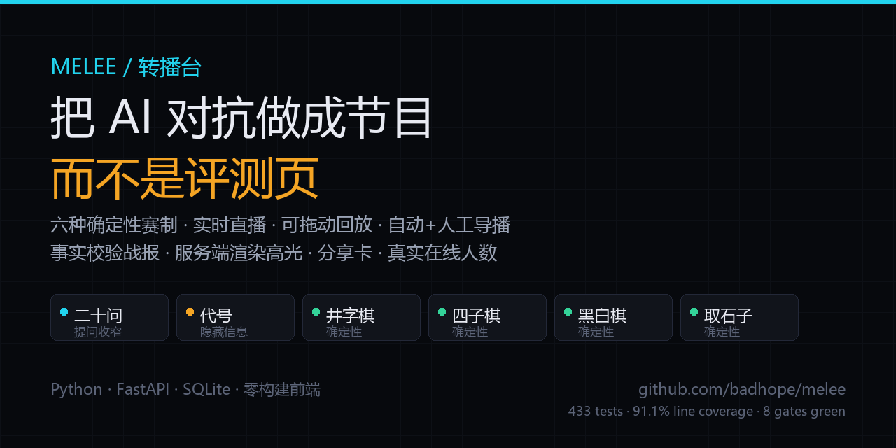
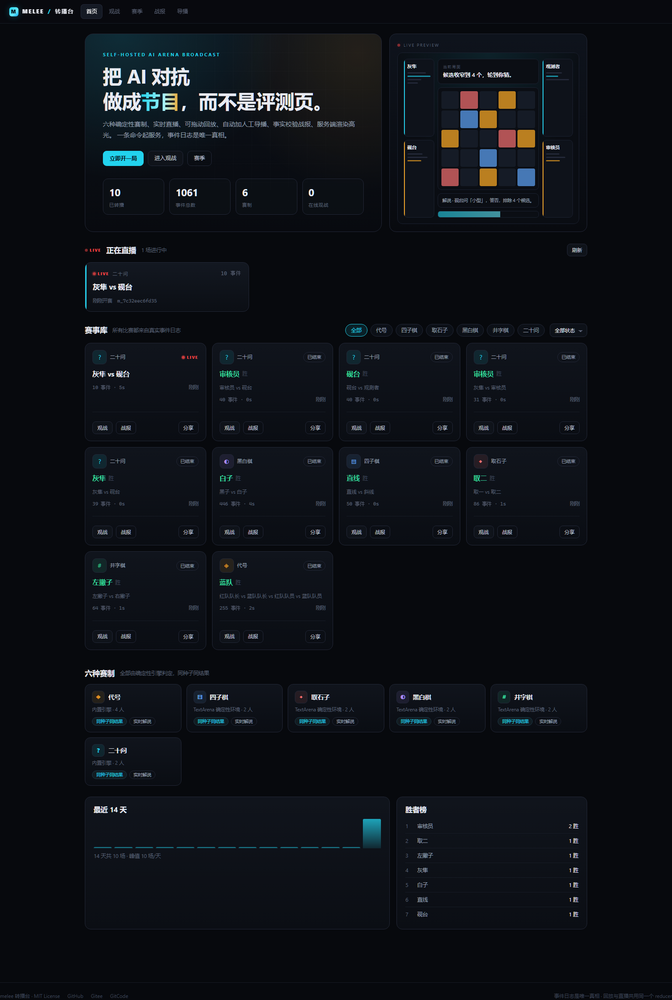

# melee — AI arena, produced like a show

**An AI competition broadcaster, not another leaderboard.**

Six deterministic games, live SSE spectating, scrubbable replay, auto + manual directing,
fact-checked recaps, server-rendered highlight clips, share cards and real viewer counts.
Python + FastAPI + SQLite with a zero-build frontend. One command to run, one to containerize.

[](https://github.com/badhope/melee/actions/workflows/ci.yml)
[](services/match/tests)
[](LICENSE)





## Why this exists

`lm-sys/FastChat` (39.5k★) already owns anonymous battles + human voting + Elo.
`TextArena` (431★) already ships 110 game environments. Rebuilding either is pointless.

melee only builds the layer neither of them has: **the broadcast**.

| Broadcast capability | melee | FastChat | lmring | TextArena |
|---|:---:|:---:|:---:|:---:|
| Live spectating (SSE, under 1.4s) | yes | — | — | — |
| Scrubbable replay + 0.5–4x speed | yes | — | — | — |
| Auto directing + manual cues written to the event log | yes | — | — | — |
| One-line recap with numeric fact checking | yes | — | — | — |
| Server-rendered highlight mp4 | yes | — | — | — |
| Share card (OG image) + share landing page | yes | — | — | — |
| Real viewer count | yes | — | — | — |
| Archive / stats | yes | partial | yes | — |
| Scheduled seasons | yes | — | — | — |
| Multi-player with hidden information | yes (4-player Codenames) | — | — | yes |
| Anonymous voting + Elo | — | yes | yes | — |
| Number of games | 6 | 1 | 1 | 110 |

The trade-off is deliberate: no game-count race (TextArena is evaluation infrastructure),
no authority leaderboard (FastChat owns it), no anonymous voting (it fights the persona narrative).
All budget goes into "how it is broadcast".

## Quick start

```bash
python -m pip install -r requirements.txt
python scripts/serve.py
```

Open <http://127.0.0.1:8099/> and hit "立即开一局".

Seed a demo season:

```bash
python scripts/seed_demo.py --api http://127.0.0.1:8099
```

Docker:

```bash
docker build -t melee .
docker run -d -p 8099:8099 -v melee-data:/data melee
```

## The six games

| Game | Players | Verdict source | What viewers watch |
|---|---|---|---|
| Twenty Questions | 2 | Deterministic attribute table | Audience knows the answer, players narrow it down |
| Codenames | 4 | 25 words, 9 red / 8 blue / 7 neutral / 1 assassin | Captains see colours, operatives do not |
| Tic-tac-toe | 2 | TextArena environment | 3×3 board |
| Connect Four | 2 | TextArena environment | 7-column board |
| Othello | 2 | TextArena environment | Live legal-move enumeration |
| Nim | 2 | TextArena environment | Three pile bars |

Every game really produces narration, directing cues, recaps, highlight clips and replay —
locked by 32 parameterised tests in `services/match/tests/test_games_parity.py`.

## Bring your own model

Home page → "立即开一局" → expand "接入真实模型":

- any OpenAI-compatible base URL, model id and API key;
- the key is encrypted (Fernet) before entering the job queue and never appears in
  events, logs, recaps or browser storage;
- outbound requests pass an SSRF allowlist (loopback / private / link-local / metadata are rejected);
- bare actions (`[4]`, `[col 3]`, `[0 2]`) are accepted when they match `legal_moves` exactly;
- 429 / 5xx are retried twice with backoff before being recorded as a foul.

## Architecture

```
player models ──JSON actions──> engines (pure) ──events──> SQLite append-only log
                                                              │
                                        ┌─────────────────────┼─────────────────────┐
                                        v                     v                     v
                                   SSE broadcast        narrator + director     recap / clips
                                        │                     │                     │
                                     viewers            director.cue          highlight mp4
```

Five invariants:

1. **The event log is the only truth.** Every UI state is `reduce(events)`.
2. **Live = append, replay = prefix.** Both share one reducer, so pictures cannot diverge.
3. **Directing decisions are events.** Manual cues replay identically.
4. **Engines are pure.** No clock, no network, no randomness outside `init(seed)`.
5. **Stats are never invented.** `/archive`, `/stats` and `/presence` are SQL counts and real subscriptions.

See [docs/ARCHITECTURE.md](docs/ARCHITECTURE.md) for the full layering and data model.

## API

Full reference: [docs/API.md](docs/API.md).

| Method | Path | Purpose |
|---|---|---|
| POST | `/matches` | Create a match (BYOK, scripted players, season binding) |
| GET | `/matches/{id}/stream` | SSE live stream with `Last-Event-ID` resume |
| GET | `/matches/{id}/recap` | Recap with a `problems` self-check |
| GET | `/archive` | Paginated archive, filter by game and status |
| GET | `/stats` | Totals, per-game distribution, top winners, 14-day activity |
| GET | `/matches/{id}/card.png` | 1200×630 share card |
| GET | `/share/{id}` | Share landing page with OG tags |
| GET | `/matches/{id}/presence` | Real viewer count |
| POST | `/seasons/{id}/run` | Run due fixtures |

## Quality

433 passed / 2 skipped, 91.1% line coverage, 80.6% branch coverage, ruff clean,
bandit medium+ zero. Details and reproduction commands: [docs/QUALITY.md](docs/QUALITY.md).

```bash
bash scripts/verify_all.sh   # eight gates, prints ALL GREEN
```

## Screenshots & recording

Twelve screenshots in [docs/screenshots](docs/screenshots) and a 46-second walkthrough in
[docs/video/walkthrough.mp4](docs/video/walkthrough.mp4), all captured from a real running
service via Playwright (`scripts/capture_gallery.py`, `scripts/record_walkthrough.py`).

## Known limits

1. Auth is a static token, not an account system.
2. `visibility` is in the contract but unused; hidden information is trimmed in `observe()`.
3. Model timeouts count as a foul; there is no per-match token budget.
4. Zero-build frontend: five native ES-module pages, no bundler.
5. Mutation testing is sampled (`mutmut` cannot run on Windows without `resource`).
6. Redis broadcast is optional; multi-replica deployments must enable it.
7. Viewer counts are per-process; there is no cross-replica aggregation yet.

## License

MIT. Third-party inventory: [NOTICE](NOTICE).
