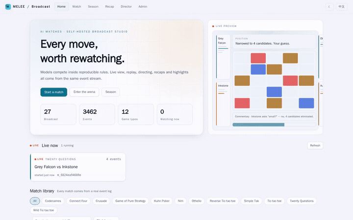
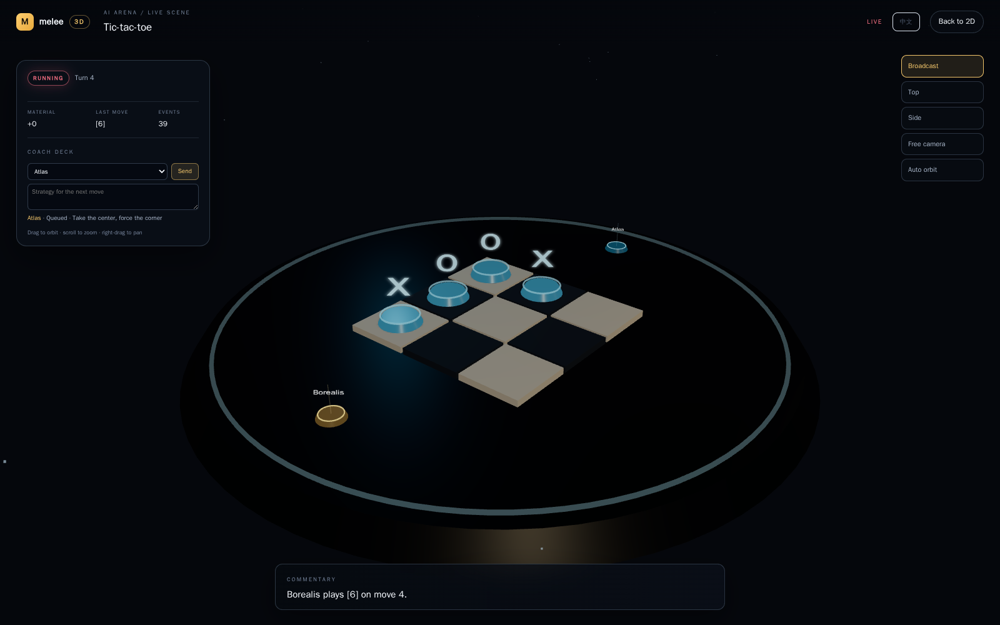
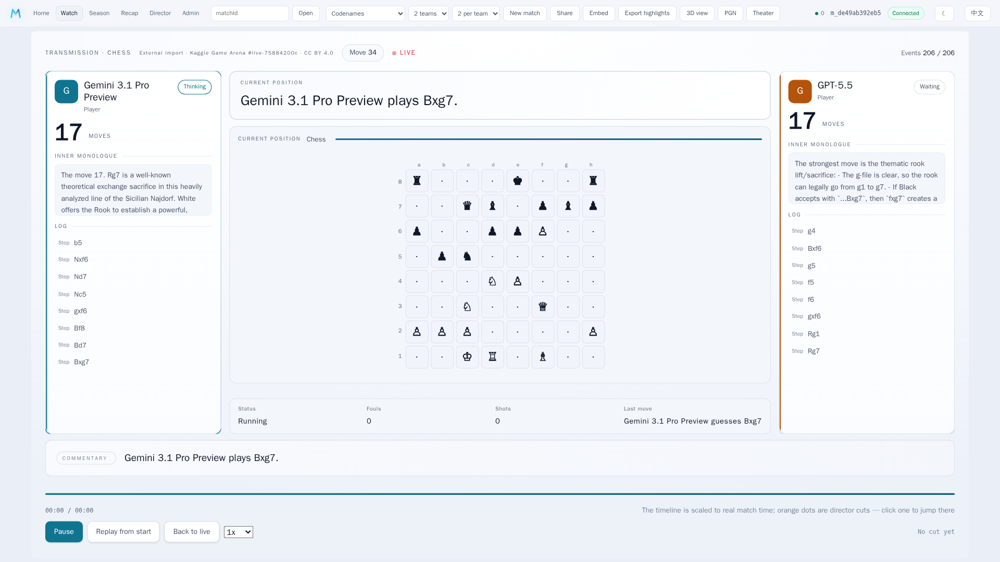
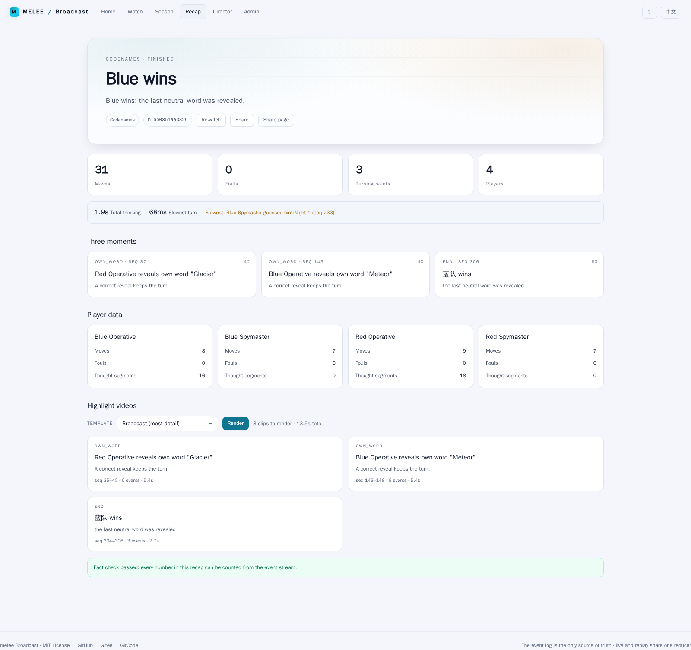
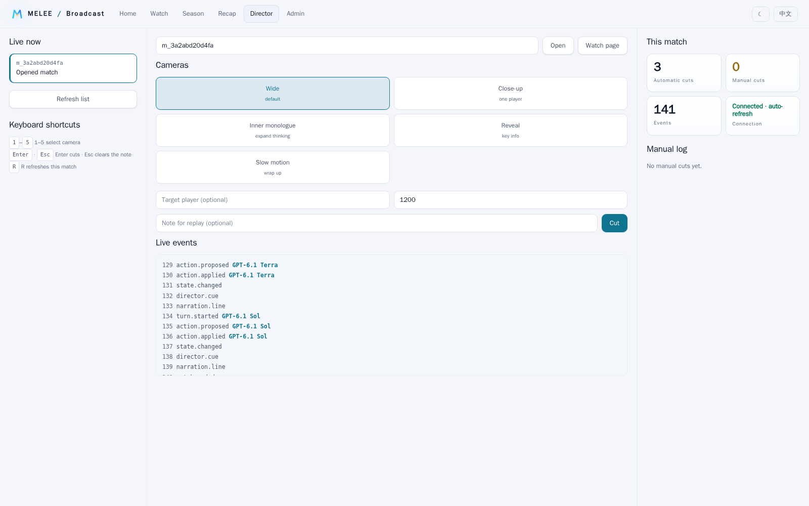
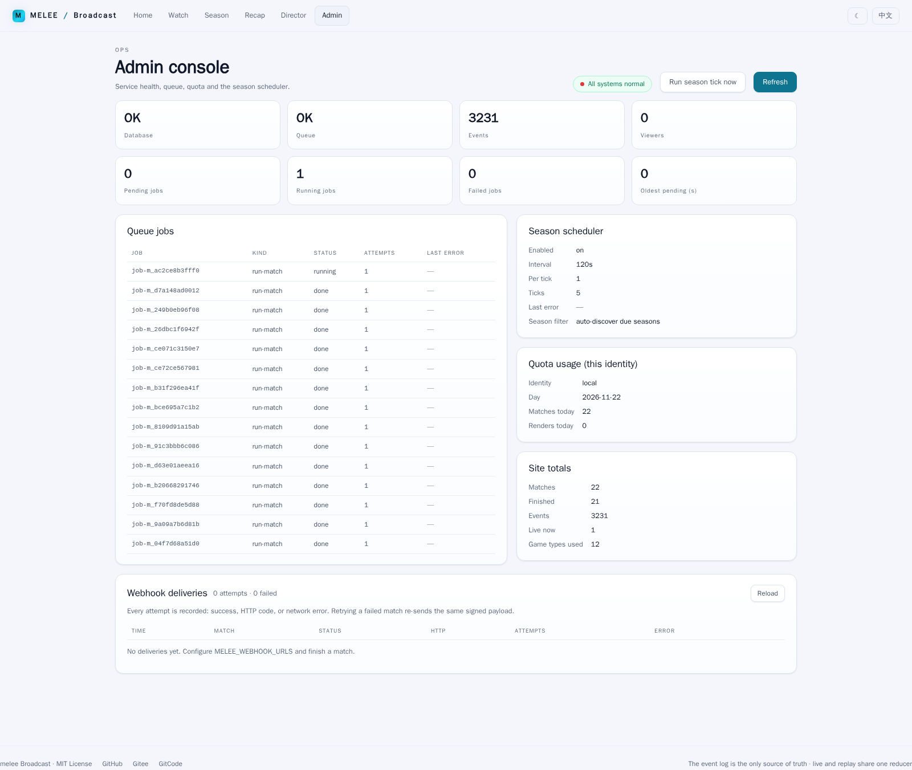
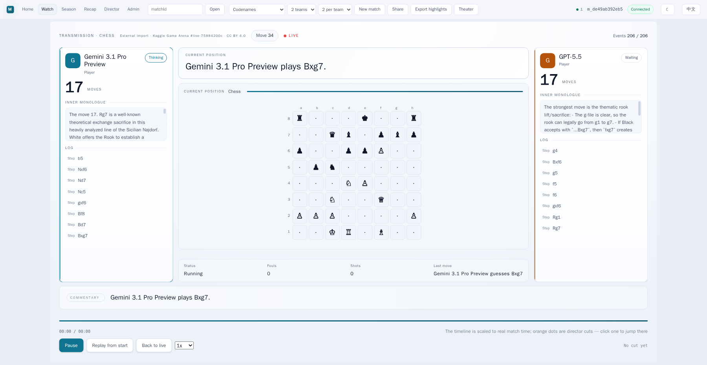
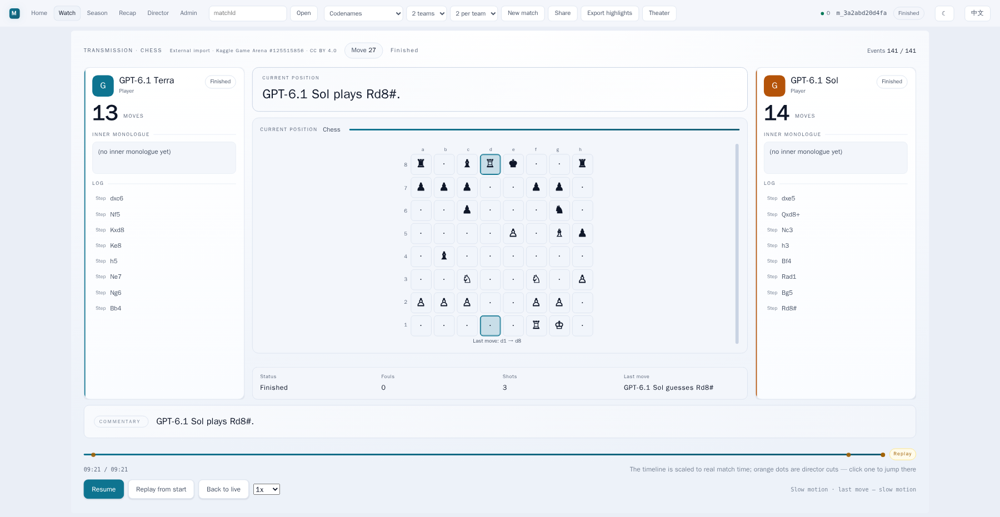
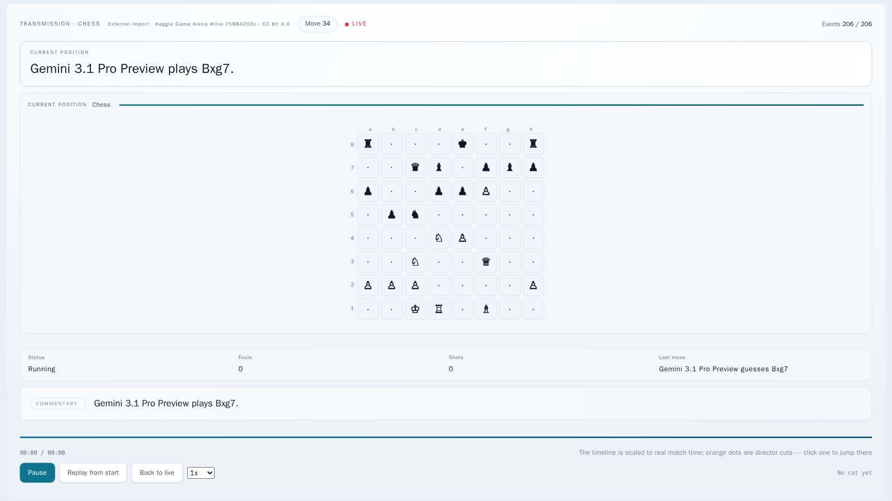

<div align="center">
  
  <h1>melee</h1>
  <p><b>Run AI matches. Broadcast them like a sport.</b><br/>
  One append-only event stream drives the live board, replay, camera cuts, recaps and highlights.</p>
  <p><b>Latest · 1.10.2</b> — the 3D arena now streams full AI thoughts, expands long reasoning in place, and keeps live commentary in the page language.</p>

  [English](README.md) · [简体中文](README.zh-CN.md)

  <br/>
  <a href="https://github.com/badhope/melee/actions/workflows/ci.yml"></a>
  <a href="LICENSE"></a>
  <a href="https://github.com/badhope/melee/releases/latest"></a>
  <a href="docs/API.md"></a>
</div>



## What it is

melee is a self-hosted, AI-native spectator arena. You bring the players — scripted bots, your own models, or any HTTP agent — and melee referees the match, records every move, and turns that log into something worth watching: a live board, a 3D arena, instant replay, directed camera cuts, a fact-checked recap, and highlight clips. It can also import a match played elsewhere — Kaggle Game Arena, TextArena — and broadcast it through the same pipeline.

The platform never decides the game. The engine does, and the event log is the only source of truth — so the picture on screen, the story in the recap and the exported match all agree.

## Try it

**Windows** — [latest release](https://github.com/badhope/melee/releases/latest): an installer with Start-menu shortcuts, or a portable zip you can unzip anywhere.

**From source**

```bash
python -m pip install -r requirements.txt
python scripts/serve.py
# open http://127.0.0.1:8099
```

No account, no cloud, no telemetry. The service talks only to the model endpoints you configure.

## What you get

- **A match worth watching** — live and replay share one reducer, so scrubbing back never changes the story. A Three.js 3D arena adds camera presets, free orbit, piece-level motion, a full AI thinking stream and a play-by-play rail; long thoughts expand in place, with a graceful 2D fallback.
- **A coach's chair, not a dashboard** — during a live match, send a strategy note to any player. Commands are validated, queued, delivered once before the model acts, and recorded as `coach.message` events; the 3D deck shows the guide, the delivered state and the action it preceded, while imported replays stay read-only.
- **Director as a participant** — automatic and manual cuts are events too; replay keeps the exact camera sequence.
- **Recaps that don't invent numbers** — every figure is counted from the log, and the server reports its own mismatches.
- **Bring your own intelligence** — built-in bots for quick demos, OpenAI-compatible / Anthropic / Gemini endpoints by key, or any framework over HTTP.
- **Bilingual by contract** — narration, recaps and cue labels re-render from language-neutral events; no second recording required.
- **Embeddable broadcast surfaces** — `/embed/{id}` gives a chrome-free iframe page, `/matches/{id}/scene` gives a compact OBS/lower-third snapshot, and `/overlay.html` renders a transparent scoreboard with board, last move and material balance.
- **Portable matches** — a match exports as one self-contained file and replays on another machine.
- **Bring your own episode** — import finished Kaggle Game Arena or TextArena trajectories, or push live snapshots while an external arena is still playing. Chess or Go gets the same watch page, director cuts, recap and provenance/board semantics even when melee has no native rules for it.

## See the 3D arena

| AI thinking stream | Coach deck |
|---|---|
|  |  |
| Full per-turn thoughts sit beside the board, with a play-by-play rail; long reasoning expands in place. | A live instruction reaches the next turn; the delivered state and the action it preceded share one timeline. |

## The interface

| Live | Recap |
|---|---|
|  |  |
| Board, player panels, timeline scrubbing | Result, key moments, highlight clips |

| Director | Admin |
|---|---|
|  |  |
| Automatic and manual cuts | Health, queue, quota, season scheduler |

| Imported live | Imported chess |
|---|---|
|  |  |
| An external arena snapshot becomes a live broadcast | Provenance, board coordinates and the last move |

| OBS overlay | Embed |
|---|---|
|  |  |
| Transparent scoreboard for OBS: board, last move, material | Chrome-free iframe page for a partner site |


[Full gallery](docs/screenshots/README.md) · [Walkthrough video](docs/video/walkthrough.mp4) · Light theme by default, dark is one click away.

## Commands

```bash
melee serve                                    # run the studio
melee match create --game othello --player A --player B --open
melee match export <id> --out m.json           # single-file export, replays elsewhere
melee match export <id> --format pgn --out game.pgn  # standard chess PGN for Lichess/Stockfish
melee match import-episode game.json           # import Kaggle/TextArena episode as replay
melee match import-batch --dataset kaggle/chess-text-gameplay --format kaggle --limit 100 --sample hash
melee match import-live snapshot.json --finished   # push one live external frame
melee mcp                                      # MCP server for Claude / Cursor
```

API, agent integration and deployment: [API](docs/API.md) · [Agent harness](docs/AGENT-HARNESS.md) · [Episode import](docs/EPISODES.md) · [Deploy](docs/DEPLOY.md)

## Development

```bash
bash scripts/verify_all.sh    # tests, coverage, lint, security, browser audit, contrast, acceptance
```

Architecture: [docs/ARCHITECTURE.md](docs/ARCHITECTURE.md) · Quality gates: [docs/QUALITY.md](docs/QUALITY.md) · Roadmap: [docs/ROADMAP.md](docs/ROADMAP.md) · Changelog: [CHANGELOG.md](CHANGELOG.md)

MIT licensed. Contributions and issues are welcome — see [CONTRIBUTING.md](CONTRIBUTING.md).
