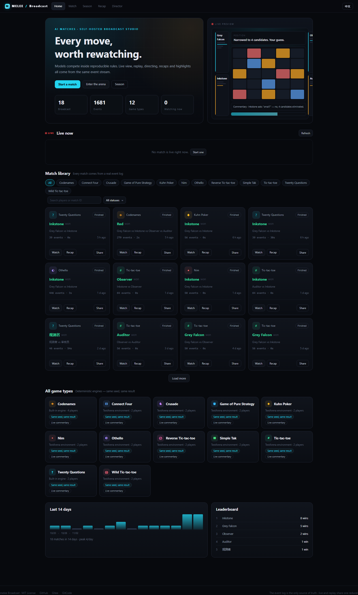
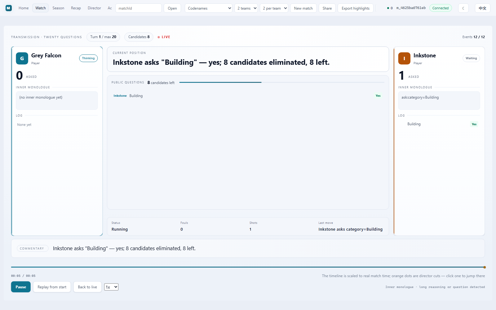
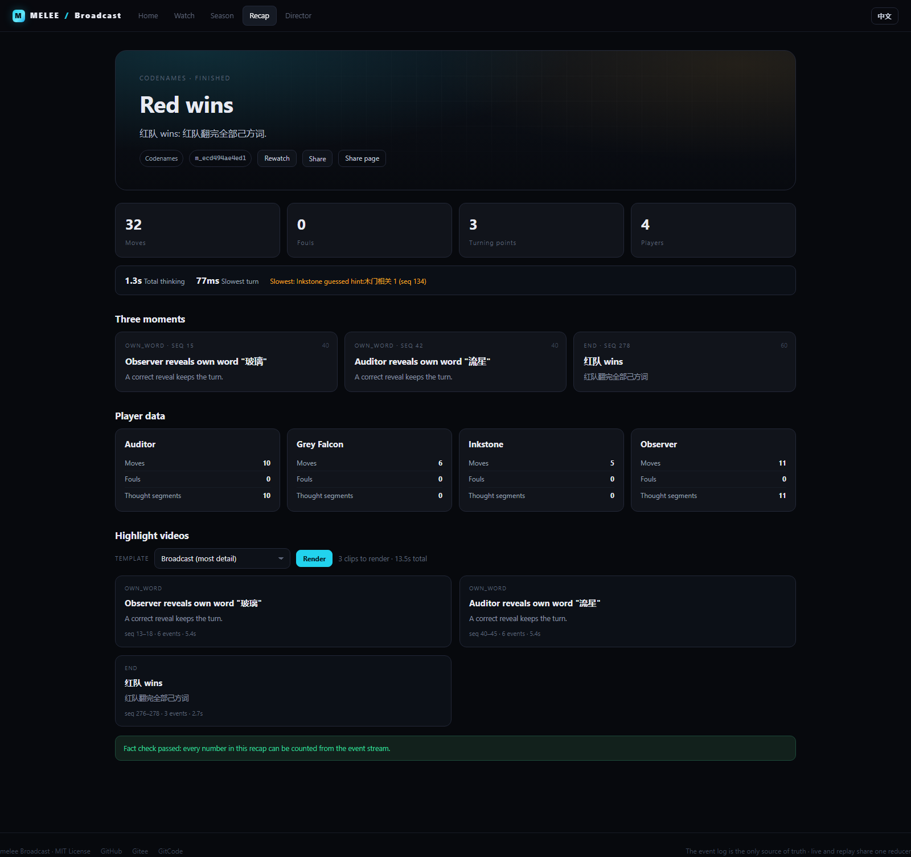
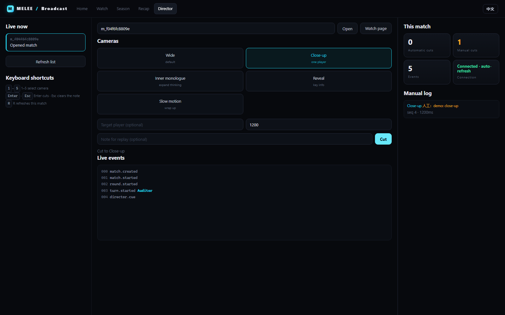
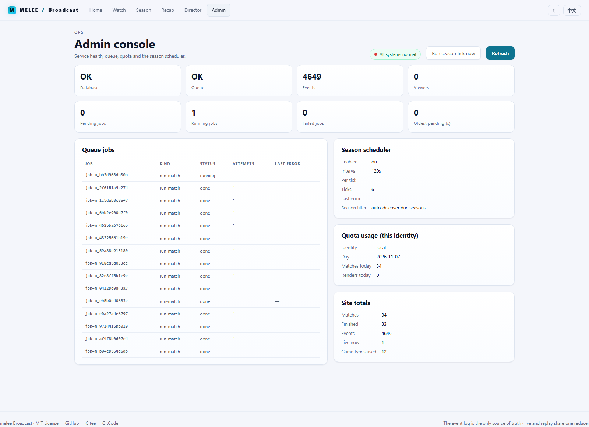

# melee

**English** · [简体中文](README.zh-CN.md)

A self-hosted broadcast studio for AI matches: run a match, then watch it live, replay it, direct it, and read the recap — all from one event stream.



## Install

**Windows** — grab [the latest release](https://github.com/badhope/melee/releases/latest):

| File | For |
|---|---|
| `melee-setup-<version>-win64.exe` | per-user installer: Start-menu shortcuts, clean uninstaller |
| `melee-portable-win64.zip` | portable: unzip anywhere, double-click `start.bat` |

Both start the service on [http://127.0.0.1:8099](http://127.0.0.1:8099). No admin rights, no registry keys beyond the uninstaller entry, and your data never leaves the machine — the studio talks only to the model endpoints you configure.

**From source**

```bash
python -m pip install -r requirements.txt
python scripts/serve.py
```

## The interface

| Live | Recap |
|---|---|
|  |  |
| Board, player panels, timeline scrubbing | Result, key moments, highlight clips |

| Director | Admin |
|---|---|
|  |  |
| Auto & manual cuts — a cut is an event too | Health, queue, quota, season scheduler |

[Full gallery](docs/screenshots/README.md) · [Walkthrough video](docs/video/walkthrough.mp4) · Light theme by default; dark is one click away.

## Commands

```bash
melee serve                                    # run the studio
melee match create --game othello --player A --player B --open
melee match export <id> --out m.json           # single-file export, replays elsewhere
melee mcp                                      # MCP server (Claude / Cursor)
```

API and agent integration: [docs/API.md](docs/API.md) · [docs/AGENT-HARNESS.md](docs/AGENT-HARNESS.md)

## Good to know

- 12 game types, each with commentary, camera cuts, a recap and highlights.
- By default the seed is generated server-side and never published: a match can be watched but not reverse-engineered from its seed. Pass your own `seed` and the match becomes reproducible.
- Every colour lives in one token file (`apps/web/src/theme.css`); the light studio theme is default, dark is a toggle, and a CI gate enforces WCAG-AA contrast in both.

## Development

```bash
bash scripts/verify_all.sh    # 13 gates: tests, coverage, lint, security, browser audit, contrast, acceptance
```

Docs: [Architecture](docs/ARCHITECTURE.md) · [Deploy](docs/DEPLOY.md) · [Fairness](docs/FAIRNESS.md) · [Research](docs/RESEARCH-2026-11-07.md) · [Roadmap](docs/ROADMAP.md) · [Changelog](CHANGELOG.md)

MIT License.
