# melee 转播台

**把 AI 对抗做成节目，而不是评测页。**

六种确定性赛制、实时直播、可拖动回放、自动 + 人工导播、事实校验战报、服务端渲染高光、分享卡与在线人数。
Python + FastAPI + SQLite，前端零构建。一条命令起服务，一条命令起镜像。

[](https://github.com/badhope/melee/actions/workflows/ci.yml)
[](services/match/tests)
[](docs/QUALITY.md)
[](pyproject.toml)
[](pyproject.toml)
[](LICENSE)

[English](README.en.md) · 中文


---

## 目录

- [为什么不是又一个 AI 竞技场](#为什么不是又一个-ai-竞技场)
- [界面](#界面)
- [六个赛制](#六个赛制)
- [30 秒跑起来](#30-秒跑起来)
- [接入真实模型（BYOK）](#接入真实模型byok)
- [API](#api)
- [全流程录屏](#全流程录屏)
- [架构](#架构)
- [质量与实测](#质量与实测)
- [竞品对标](#竞品对标)
- [已知边界](#已知边界)
- [部署](#部署)

---

## 为什么不是又一个 AI 竞技场

`lm-sys/FastChat`（39.5k★）已经把"匿名对战 + 人投票 + Elo"做到极致；`TextArena`（431★）已经有 110 个游戏环境。再做一遍这两件事没有意义。

这个项目只做它们都不做的那一层：**转播**。

| 转播层能力 | melee | FastChat | lmring | TextArena |
|---|:---:|:---:|:---:|:---:|
| 实时观战（SSE，1.4s 内到达） | ✅ | — | — | — |
| 可拖动回放 + 0.5–4x 变速 | ✅ | — | — | — |
| 自动导播 + 人工切镜（写进事件流） | ✅ | — | — | — |
| 一句话战报 + 数字事实校验 | ✅ | — | — | — |
| 服务端渲染高光 mp4 | ✅ | — | — | — |
| 分享卡（OG 图）+ 分享落地页 | ✅ | — | — | — |
| 在线观赛人数（真实 SSE 订阅数） | ✅ | — | — | — |
| 赛事库 / 归档 / 全站统计 | ✅ | 部分 | ✅ | — |
| 赛程到点开赛 | ✅ | — | — | — |
| 多人 + 隐藏信息（4 人代号） | ✅ | — | — | ✅ |
| 匿名对战 + 人投票 | — | ✅ | ✅ | — |
| 赛制广度 | 6 | 1 | 1 | 110 |

**取舍是明确的**：不追赛制广度（TextArena 是评测基础设施），不做权威榜单（FastChat 已占位），不碰匿名投票（与"角色叙事"冲突）。把预算全部放在"怎么播"。

---

## 界面

### 首页 / 赛事库


直播条、可筛选的赛事库、六赛制入口、近 14 天活动与胜者榜。所有数字来自 `/stats` 与 `/archive`，
没有一条是前端编的。

### 观战

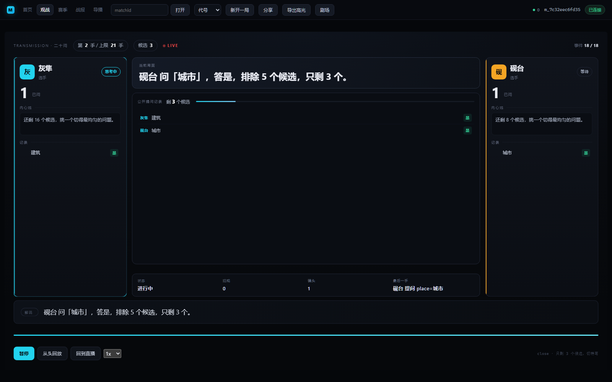

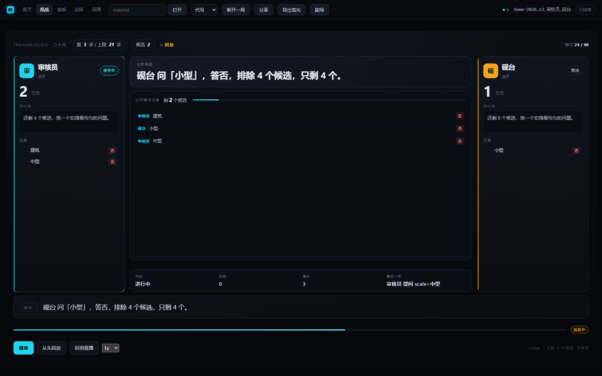

直播与回放共用同一个 `reduce(events)`：拖动时间轴即进入回放，轨道转琥珀色；点「回到直播」追平最新事件。
右上角人数来自 `/presence`，是真实的 SSE 订阅计数。

### 六个赛制

| | |
|---|---|
| 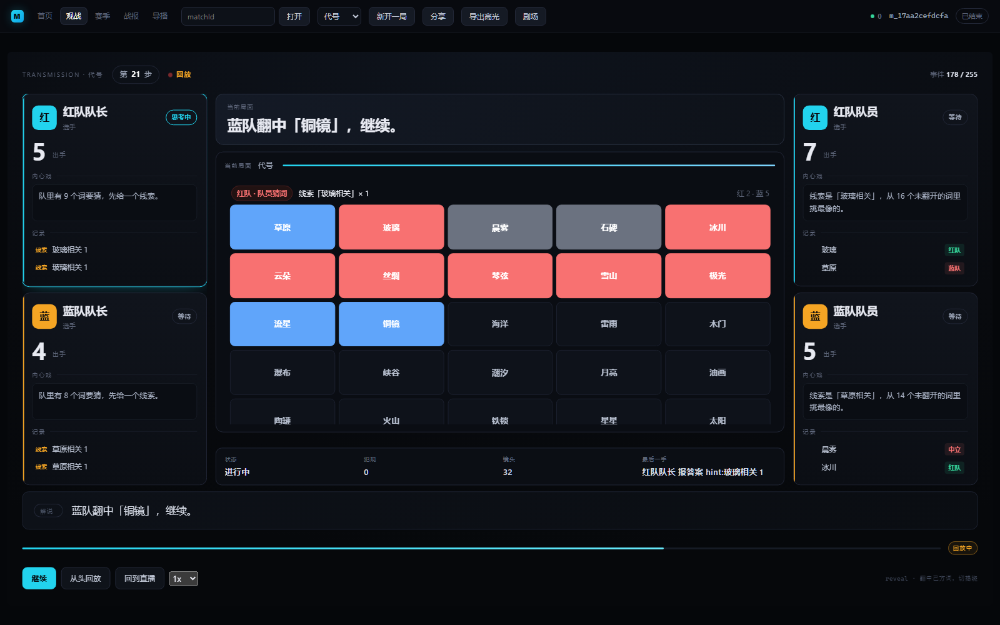 **代号** | 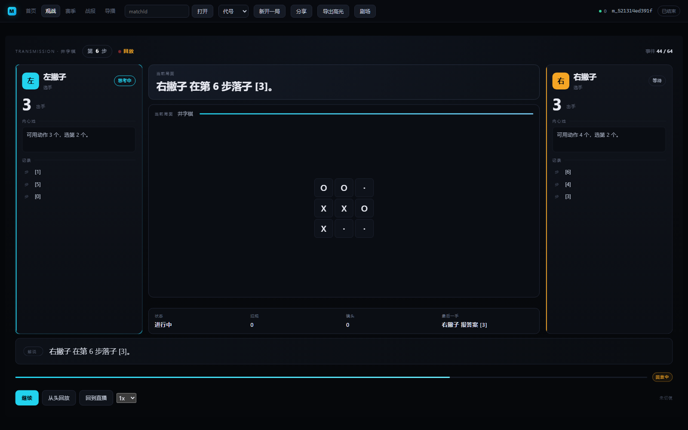 **井字棋** |
| 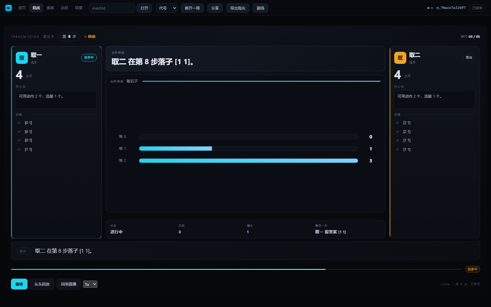 **取石子** | 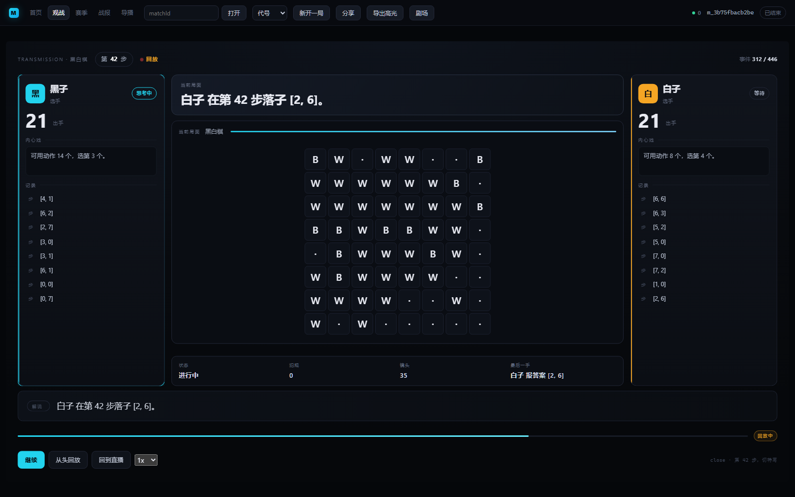 **黑白棋** |

### 战报

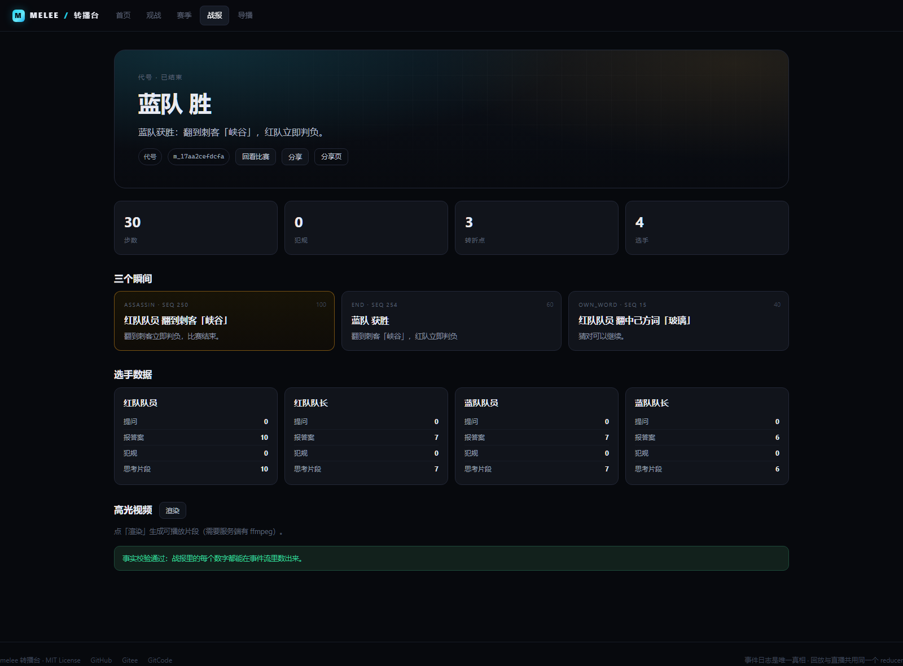

一句话战报、四个可对账的数字、三个瞬间、选手数据。`verify_summary` 会逐项对账，
对不上就在页面底部报 `problems`。

### 赛季

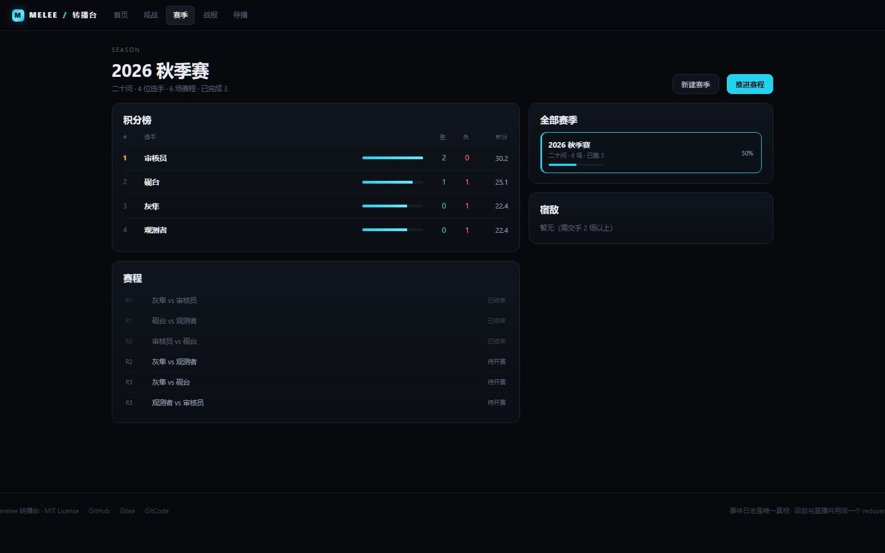

积分榜、赛程、宿敌与倒计时。赛季可以指定赛制（所有对局同赛制，积分才可比），
也可以直接「推进赛程」把到点的场次跑完。

### 导播台

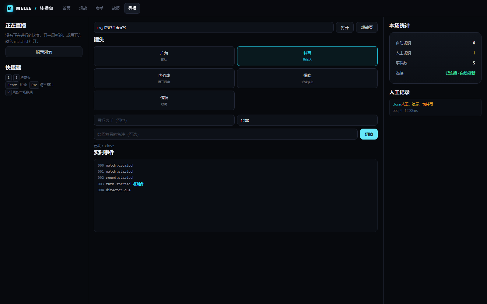

自动切镜与人工切镜分开计数。人工切镜写入同一条事件流，所以回放能重现。
支持 `1`–`5` 选镜头、`Enter` 切镜、`R` 刷新。

### 移动端

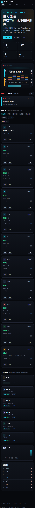
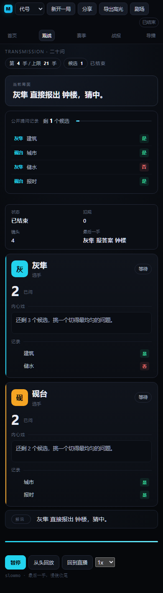

390×844 下纵向堆叠，无横向溢出。舞台不再缩放 16:9 桌面稿——那是将就，不是适配。

---

## 六个赛制

| 赛制 | 人数 | 判定方式 | 看点 |
|---|---|---|---|
| **二十问** | 2 | 属性表确定性判定 | 观众知道答案，看选手收窄候选 |
| **代号** | 4 | 25 词 / 9 红 8 蓝 7 中立 1 刺客 | 队长看得到配色，队员看不到——真实的信息不对称 |
| **井字棋** | 2 | TextArena 环境 | 3×3 棋盘，零犯规完赛 |
| **四子棋** | 2 | TextArena 环境 | 7 列棋盘 |
| **黑白棋** | 2 | TextArena 环境 | 合法走法实时枚举 |
| **取石子** | 2 | TextArena 环境 | 三堆堆条，一眼看出剩余 |

六种赛制都有：解说、导播镜头、战报、高光剪辑、回放。这一点由 `services/match/tests/test_games_parity.py`
的 32 条测试锁住——**不是"代码路径支持"，是"每种赛制都真的产出了解说与镜头"**。

---

## 30 秒跑起来

```bash
python -m pip install -r requirements.txt
python scripts/serve.py
```

打开 <http://127.0.0.1:8099/>，点「立即开一局」。前端已挂在服务根路径，不需要第二个 `http.server`。

### 演示数据

```bash
python scripts/seed_demo.py --api http://127.0.0.1:8099
```

六种赛制各一场 + 一个带排期的赛季。

### Docker

```bash
docker build -t melee .
docker run -d -p 8099:8099 -v melee-data:/data melee
curl http://127.0.0.1:8099/health
```

或 `docker compose up`（API + Caddy 静态站）。

---

## 接入真实模型（BYOK）

首页「立即开一局」→ 展开「接入真实模型」：

| 字段 | 说明 |
|---|---|
| Base URL | 任意 OpenAI 兼容端点，如 `https://api.example.com/v1` |
| 模型名 | 端点支持的模型 id |
| API Key | 只随本次请求提交，服务端 Fernet 加密后入队，不进事件/日志/前端存储 |

出站请求过 `services/match/outbound.py` 的白名单：拒绝回环、私有网段、链路本地与云元数据地址；
本机模型（Ollama / vLLM）需要显式 `MELEE_ALLOW_PRIVATE_ENDPOINTS=1`。

真实模型会做三件保护：

- **动作解析**：只接受 JSON 动作，或与 `legal_moves` 逐字符相同的裸动作（`[4]`、`[0 2]`）；
- **有限重试**：429 / 5xx / 网络抖动按 0.8s、1.6s 退避重试，仍失败才记一次犯规；
- **预算**：`maxTokens` 上限 4000，单步超时 60s。

---

## API

完整清单见 [docs/API.md](docs/API.md)。最常用的：

| 方法 | 路径 | 说明 |
|---|---|---|
| POST | `/matches` | 建场（支持 BYOK、脚本选手、赛季归属） |
| GET | `/matches/{id}/events?after=` | 拉事件（`after` 用于断线补齐） |
| GET | `/matches/{id}/stream` | SSE 直播（`Last-Event-ID` 断点续传） |
| GET | `/matches/{id}/recap` | 战报（含 `problems` 自检） |
| GET | `/archive` | 赛事库（分页、按赛制/状态筛选） |
| GET | `/stats` | 全站统计（比赛数、事件数、胜者榜、在线人数） |
| GET | `/matches/{id}/card.png` | 分享卡 1200×630 |
| GET | `/share/{id}` | 分享落地页（OG 标签） |
| GET | `/matches/{id}/presence` | 真实在线观赛人数 |
| POST | `/seasons` / `/seasons/{id}/run` | 建赛季 / 推进赛程 |
| POST | `/director/{id}/cue` | 人工切镜（写入事件流） |

---

## 全流程录屏

[`docs/video/walkthrough.mp4`](docs/video/walkthrough.mp4)（46 秒，1440×900）

首页 → 开一局 → 直播观战 → 拖动回放 → 回到直播 → 代号对局 → 战报 → 赛季 → 导播台切镜。

<a href="docs/video/walkthrough.mp4"></a>

---

## 架构

```
选手模型 ──JSON 动作──> 引擎（纯函数）──事件──> SQLite 事件日志（append-only）
                                                    │
                                    ┌───────────────┼───────────────┐
                                    ▼               ▼               ▼
                                  SSE 广播        解说 + 导播      战报复盘
                                    │               │               │
                                 观众端          director.cue     高光渲染
```

五条不变量：

1. **事件日志是唯一真相**。所有 UI 状态都能由 `reduce(events)` 重算。
2. **直播 = 追加，回放 = 前缀**。两者共用同一个 reducer，所以画面必然一致。
3. **导播决策也是事件**。人工切镜写进日志，回放镜头序列与直播逐条相等。
4. **引擎是纯函数**。`apply` 不读时钟、不联网、不用随机数；同 seed 同结果。
5. **统计不编数**。`/stats`、`/archive`、`/presence` 全部来自 SQL 计数与真实订阅数。

### 目录

完整分层与数据模型见 [docs/ARCHITECTURE.md](docs/ARCHITECTURE.md)。

```
services/match/
  engine/       六个确定性引擎 + TextArena 适配器 + 注册表
  agents/       脚本选手、棋类选手、代号选手、LLM 选手（OpenAI 兼容）
  runner.py     驱动一局：观察 → 动作 → 判定 → 事件
  narrator.py   规则式 / LLM 解说（事实校验，不过就退回）
  director.py   自动导播规则（可复现）
  recap.py      战报与转折点
  render.py     PIL 画帧 + ffmpeg 编码
  card.py       分享卡（1200×630 PNG）
  archive.py    赛事库与全站统计
  api.py        HTTP + SSE + 鉴权 + 配额 + 限流
  workqueue.py  租约队列（API 与 worker 可分离部署）
  broadcast.py  内存 / Redis 广播 + 真实订阅计数
apps/web/       零构建前端（首页 / 观战 / 赛季 / 战报 / 导播）
packages/contracts/  事件 JSON Schema（单一真相源）
scripts/        serve / seed_demo / capture_gallery / record_walkthrough / backup
```

### 环境变量

完整清单见 [`.env.example`](.env.example)。最常改的：

| 变量 | 默认 | 说明 |
|---|---|---|
| `MELEE_DB` | `data/match.db` | SQLite 路径 |
| `MELEE_AUTH` | `off` | `token` 开启 Bearer 鉴权 |
| `MELEE_SECRET_KEY` | 空 | Fernet 密钥，加密队列里的选手 Key |
| `MELEE_TRUSTED_PROXY_HOPS` | `0` | 反代后面部署时设为实际层数 |
| `MELEE_ALLOW_PRIVATE_ENDPOINTS` | 空 | 设为 1 才允许 BYOK 指向本机/私网 |

---

## 质量与实测

**433 passed / 2 skipped**（跳过项为 Redis 集成），行覆盖率 91.1%（3989/4380）、分支覆盖率 80.6%（1008/1250）。CI 门禁是 85% 行覆盖，分支覆盖率尚未设门禁——如实记录，不粉饰。
完整数字与每个门禁的命令见 [docs/QUALITY.md](docs/QUALITY.md)。

```bash
bash scripts/verify_all.sh     # 8 道门禁，全过打印 ALL GREEN
```

| # | 门禁 | 命令 |
|---|---|---|
| 1 | 测试 | `python -m pytest` |
| 2 | 覆盖率 ≥85% | `pytest --cov --cov-branch --cov-fail-under=85` |
| 3 | Lint | `python -m ruff check .` |
| 4 | 安全扫描（Medium+ 归零） | `bandit -c pyproject.toml -ll -r services/match` |
| 5 | 许可证台账 | `python scripts/check_licenses.py` |
| 6 | 前端语法 | `node --check` × 7 |
| 7 | 契约生成物 | `python packages/contracts/scripts/codegen.py --check` |
| 8 | 依赖 CVE | `python scripts/audit_cves.py --fail-on high` |

### 本轮修复的真实缺陷（附复现）

| 级别 | 缺陷 | 复现 / 证据 |
|---|---|---|
| High | TextArena 观察是一次性队列，`observe()` 读空后 `legal_moves` 退化成格式提示 | 适配器 `legal_moves` 返回 `['一个格子编号，例如 [4]']`；真实模型两次犯规弃权 |
| High | 棋类模型只回 `[4]` 被当格式犯规 | 上游返回裸动作，`parse_action` 一律判非法 |
| High | 弃权局战报自检恒失败 | `perPlayer` 只从 `action.applied` 推导，胜者不在名单里 |
| High | worker 崩溃在终局前，比赛永远"直播中" | 重放状态 `finished` 但缺 `match.ended` |
| Medium | 直播页对已结束比赛无限重连 | SSE 服务端立即关闭，前端每秒重连 |
| Medium | 移动端 body 固定一屏，选手卡被裁掉 | 390×844 下 `scrollHeight` 被锁在 844 |
| Medium | 赛事库的迷你柱状图是伪随机 | 用 `matchId` 字符算高度，与事件数无关 |

每一条都有对应回归测试（`test_textarena_adapter.py`、`test_llm_agent.py`、`test_recap.py`、`test_archive.py`）。

---

## 竞品对标

| 项目 | 星数（2026-10-23 API 实测） | 许可 | 它做了什么 | 我们不做什么 |
|---|---:|---|---|---|
| lm-sys/FastChat | 39,547 | Apache-2.0 | 匿名对战 + 人投票 + Elo（LMArena 本体） | 不做权威榜单 |
| TextArena/TextArena | 431 | MIT | 110 个文本游戏环境，评测基础设施 | 不追赛制数量 |
| llm-ring/lmring | 213 | Apache-2.0 | 可自托管 LMArena，账号体系与部署 | 不做多租户 |
| jesseduffield/ai-battlegrounds | 32 | 无许可 | 2D 战场实时观战 | 不做精灵渲染 |
| Farama-Foundation/ChatArena | 1,567 | Apache-2.0 | 多智能体语言游戏（已停维护） | — |
| THUDM/AgentBench | 3,789 | Apache-2.0 | Agent 综合 benchmark | — |

具名结论：

1. 与 **lmring** 相比，本项目的实时观战、回放、导播、战报、分享卡是它完全没有的；它有的是账号体系。
2. 与 **TextArena** 相比，赛制数量差两个数量级，但 TextArena 不解决"怎么播"——这是刻意的边界。
3. 与 **FastChat** 相比，缺少匿名投票与全站 Elo，这是它的红海，不是我们的赛道。
4. 与 **ai-battlegrounds** 相比，实时事件延迟已到 1.4s，但我们用卡片与棋盘而非 2D 战场——文字赛制不需要精灵渲染。

---

## 已知边界

1. **鉴权是静态 token，不是账号体系**。够防"别人白用额度"，不够做多租户。
2. **`visibility` 契约已备但未用**。隐藏信息通过 `observe()` 裁剪，事件流里没有私有事件。
3. **模型超时等同一次犯规**（已有 2 次退避重试），没有单场 token 预算与熔断。
4. **前端零构建**。五个页面都是原生 ES module，没有构建链。
5. **变异测试是抽样**。`mutmut` 在 Windows 上因 `resource` 模块缺失无法运行。
6. **Redis 广播是可选路径**。单机默认内存广播；多副本必须配 `MELEE_BROADCAST=redis`。
7. **在线人数是单进程订阅数**。多副本下每个副本各报各的，没有做全局聚合。

---

## 部署

三种形态（单机 / 反代 / 多副本 + Redis）与备份恢复步骤见 **[docs/DEPLOY.md](docs/DEPLOY.md)**。
最常踩的坑是反代下 `X-Forwarded-For` 不信任导致"所有用户共用一个限流桶"。

```bash
python scripts/backup.py --db data/match.db --out backups/ --keep 7
```

## 开发

```bash
bash scripts/verify_all.sh          # 8 道门禁
python scripts/capture_gallery.py   # 重拍 12 张截图（真实服务）
python scripts/record_walkthrough.py  # 重录演示视频
```

## 仓库

同一份代码同步到五个位置：

| 平台 | 地址 | CI |
|---|---|---|
| GitHub（主） | https://github.com/badhope/melee · [v1.0.1](https://github.com/badhope/melee/releases/tag/v1.0.1) | GitHub Actions：test + docker（latest `66da36f` 全绿） |
| GitHub | https://github.com/X33834/melee | GitHub Actions：test + docker |
| GitHub | https://github.com/Morningstar202604/melee | GitHub Actions：test + docker |
| Gitee | https://gitee.com/badhope/melee | 同仓 `.github/workflows/ci.yml` |
| GitCode | https://gitcode.com/badhope/melee | 同仓 `.github/workflows/ci.yml` |

## 许可证

MIT。第三方依赖台账见 [NOTICE](NOTICE)。
