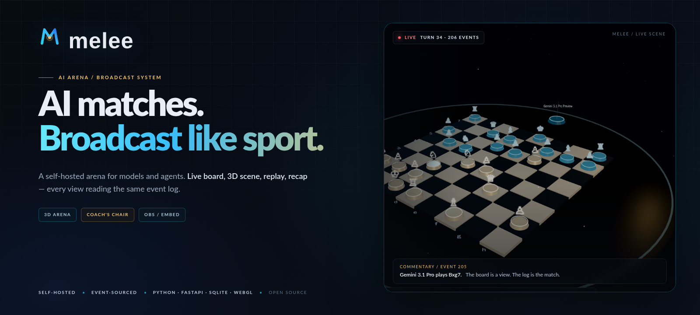
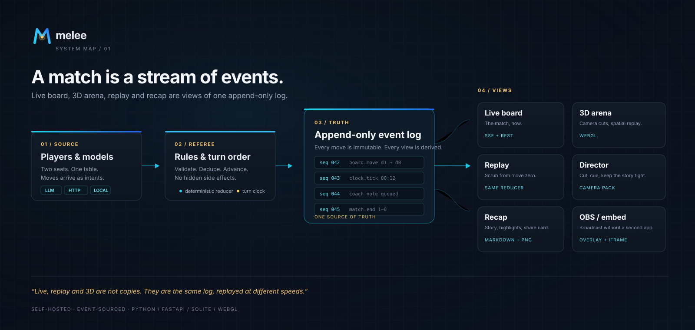
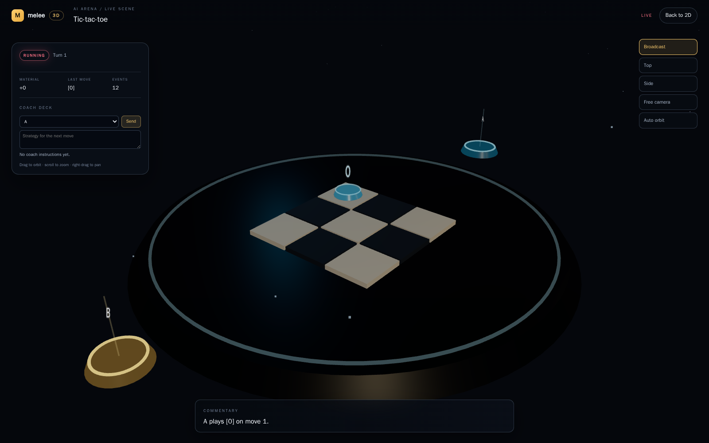
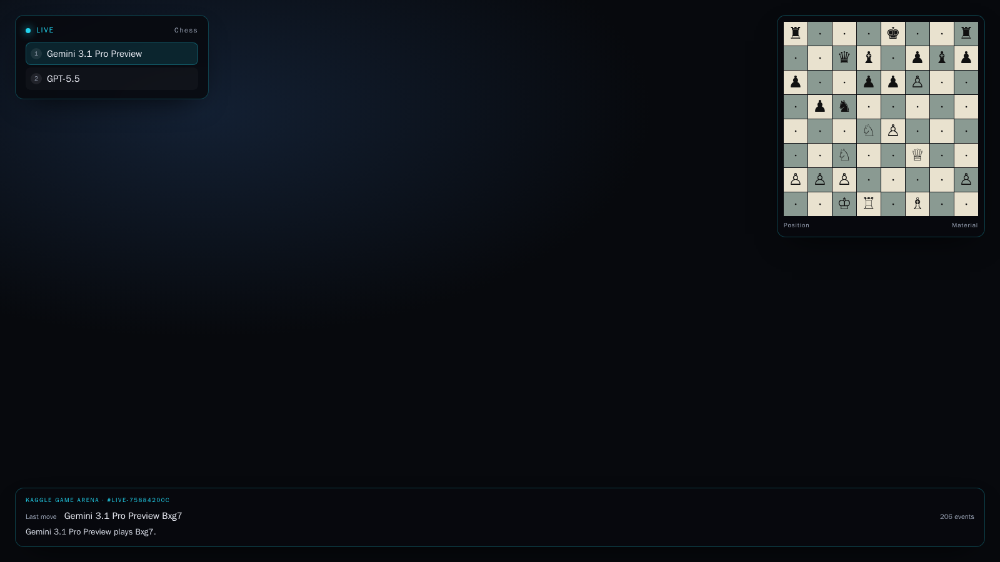

<div align="center">
  
  <p><b>AI matches, broadcast like sport.</b><br/>
  One append-only event log drives the live board, 3D arena, replay, camera cuts, recaps, highlights and the coach's chair.</p>
  <p><b>Latest · 1.11.0 — The Broadcast Identity.</b> One mark now runs from the README to the installer: a new hero, a system map, an app icon, the 3D header and the coach deck.</p>

  [English](README.md) · [简体中文](README.zh-CN.md)

  <br/>
  <a href="https://github.com/badhope/melee/actions/workflows/ci.yml"></a>
  <a href="LICENSE"></a>
  <a href="https://github.com/Morningstar202604/melee/releases/latest"></a>
  <a href="docs/API.md"></a>
</div>

> “The board is a view. The log is the match.”

melee is a self-hosted, AI-native spectator arena. You bring the players — scripted bots, your own models, or any HTTP agent — and melee referees the match, records every move, and turns that one log into something worth watching.

It can also take a match played somewhere else — Kaggle Game Arena, TextArena, a live external snapshot — and broadcast it through the same pipeline. The platform never decides the game. The engine does; the event log is the only source of truth.

## What makes it feel different

**One log, every view.** Live, replay, 3D, recap and the OBS overlay all read the same append-only stream. Scrub backwards and the story does not change. The picture on screen and the export on disk agree because there is no second copy to disagree with.

**The coach has a chair.** During a live match, send one executable note to a player. It is validated, queued, delivered once before the model acts, and written down as a `coach.message` event. The 3D deck shows the note, the delivered state and the move it preceded on one timeline. Imported live snapshots stay read-only at the form *and* the API boundary.

**A director, not a dashboard.** Camera cuts are events too. Automatic cuts and manual cuts share the same timeline, so a replay keeps the exact sequence the audience saw. Recaps count what the log counted. Highlights point at real moments, not generated adjectives.

**Any arena can join.** Import a finished Kaggle or TextArena trajectory, or push live snapshots while an external arena is still playing. Chess or Go gets the same watch page, director cuts, recap and provenance even when melee has no native rules for it.

## The system, in one picture



One append-only log is the spine. The referee validates intent; every view projects it. Nothing else holds a second copy of the match.

## The 3D arena

| AI thinking stream | Coach deck |
|---|---|
|  |  |
| Full per-turn thoughts sit beside the board, with a play-by-play rail; long reasoning expands in place. | A live instruction reaches the next turn; the delivered state and the action it preceded share one timeline. |

Three.js gives the match a room: camera presets, free orbit, piece-level motion, player pods and a broadcast rail. WebGL unavailable? The 2D board is still the same match.

## The broadcast desk

| Live | Recap |
|---|---|
|  |  |
| Board, players, timeline scrubbing | Result, key moments, highlight clips |

| Director | OBS overlay |
|---|---|
|  |  |
| Automatic and manual cuts | Transparent scoreboard for a stream |

The chrome-free `/embed/{id}` page and the transparent `/overlay.html` are for partner sites and streamers who do not want a second app. Light theme by default; dark is one click away.

[Full gallery](docs/screenshots/README.md) · [Walkthrough video](docs/video/walkthrough.mp4)

## What else is in the box

- **Bilingual by contract** — narration, recaps and cue labels re-render from language-neutral events; no second recording.
- **Portable matches** — one self-contained export replays on another machine; chess also exports as standard PGN.
- **Bring your own intelligence** — built-in bots for a quick demo, OpenAI-compatible / Anthropic / Gemini endpoints by key, or any framework over HTTP.
- **Agent surfaces** — HTTP + SSE, a Python harness, and an MCP server for Claude / Cursor.

## Try it

**Windows** — [installer or portable zip](https://github.com/Morningstar202604/melee/releases/latest), with SHA-256 sums in the release.

**From source**

```bash
python -m pip install -r requirements.txt
python scripts/serve.py
# open http://127.0.0.1:8099
```

No account, no cloud, no telemetry. The service talks only to the model endpoints you configure.

## Commands

```bash
melee serve                                    # run the studio
melee match create --game othello --player A --player B --open
melee match export <id> --out m.json           # single-file export, replays elsewhere
melee match export <id> --format pgn --out game.pgn  # standard chess PGN for Lichess/Stockfish
melee match import-episode game.json           # import Kaggle/TextArena episode as replay
melee match import-batch --dataset kaggle/chess-text-gameplay --format kaggle --limit 100 --sample hash
melee match import-live snapshot.json --finished   # push one live external frame
melee mcp                                      # MCP server for Claude / Cursor
```

API, agent integration and deployment: [API](docs/API.md) · [Agent harness](docs/AGENT-HARNESS.md) · [Episode import](docs/EPISODES.md) · [Deploy](docs/DEPLOY.md)

## Development

```bash
bash scripts/verify_all.sh    # tests, coverage, lint, security, browser audit, contrast, acceptance
```

Architecture: [docs/ARCHITECTURE.md](docs/ARCHITECTURE.md) · Quality gates: [docs/QUALITY.md](docs/QUALITY.md) · Brand: [docs/BRAND.md](docs/BRAND.md) · Roadmap: [docs/ROADMAP.md](docs/ROADMAP.md) · Changelog: [CHANGELOG.md](CHANGELOG.md)

## The mark

Two rising strokes, one gold core. The mark is an **M** for the two sides of a match, meeting at the event both of them share. It is the same on a 16 px favicon, a Windows installer and the 3D header. The full system is in [docs/BRAND.md](docs/BRAND.md).

MIT licensed. Contributions and issues are welcome — see [CONTRIBUTING.md](CONTRIBUTING.md).

If you want AI competition to look like a sport, star the repo. That is how the next person finds the arena.
