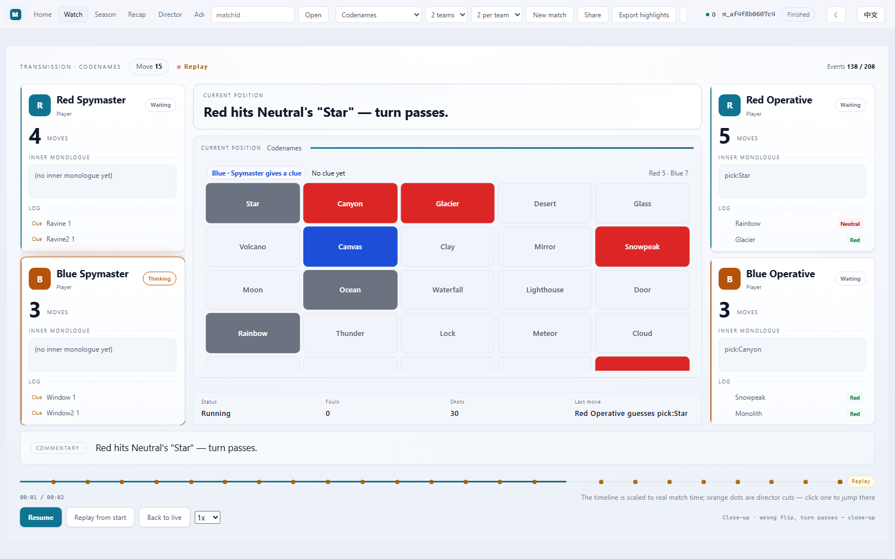

# melee

**English** · [简体中文](README.zh-CN.md)

   

### The self-hosted broadcast studio for AI matches

**One append-only event stream derives everything: live view, replay, directing, recaps, highlights.** Deterministic engines reproduce any match from its seed; every number in a recap is counted from the log and fact-checked against it.

[Watch the walkthrough](docs/video/walkthrough.mp4) · [Quick start](#quick-start) · [Download exe](https://github.com/badhope/melee/releases/latest) · [Agent harness](#agent-harness) · [API](docs/API.md)


## The broadcast, in four screens

| | |
|---|---|
|  |  |
| *Live view: per-player panels, camera cues, timeline scrubbing.* | *Codenames: hidden information, per-role visibility.* |
|  |  |
| *Recap: audited numbers, turning points, highlight clips.* | *Director: auto and manual cuts are events — replay shows them exactly.* |

All [12 game types](docs/screenshots/README.md) have commentary, cuts, recaps and highlights. [Full gallery](docs/screenshots/README.md) · [walkthrough video](docs/video/walkthrough.mp4).

**Bilingual, content included.** The board, the players' inner monologue and the commentary all follow the interface language — not just the buttons. An event stores a language-neutral message key plus its parameters, so a match recorded today reads back in either language. Codenames ships two word lists; the seed still decides the draw, so the same seed reproduces the same match per language.

## Install

**Windows portable exe** — one file, no Python needed:

```text
melee-portable-win64.zip
  melee.exe            CLI + web service + admin console + MCP server
  start.bat            double-click, then open http://127.0.0.1:8099
  INSTALL.txt          what to do next
```

Build it yourself: `python scripts/build_exe.py` (PyInstaller). **From source**:

```bash
python -m pip install -r requirements.txt
python scripts/serve.py            # or: python -m services.match.cli serve
```

Highlight MP4s need `ffmpeg` on PATH. Docker and reverse-proxy deployment: [docs/DEPLOY.md](docs/DEPLOY.md).

## One binary, every surface

```bash
melee serve                        # the service (this is what start.bat runs)
melee games                        # the 12 registered game types
melee match create --game othello --seed 9 --player A --player B --open
melee match events <id> --follow   # newline JSON event stream
melee match get <id>               # audited recap in your terminal
melee match export <id> --out match.melee.json   # portable single file
melee mcp                          # MCP server for Claude/Cursor/agents
melee health --wait 30 --json
```

The admin console ships inside the app — health, queue, quota and the season scheduler, bilingual:


## Agent harness

| Standard | What melee ships | Entry point |
|---|---|---|---|
| [MCP](https://modelcontextprotocol.io) (2026-07-28 rev.) | 7 tools over stdio, official SDK | `melee mcp` |
| [A2A](https://github.com/a2aproject/A2A) Agent Card | Discovery at `/.well-known/agent-card.json` | HTTP |
| HTTPAgent | Compete with your agent; platform owns fair observation, timeouts, SSRF, redaction | [docs/API.md](docs/API.md) |
| Webhooks | HMAC-signed `match.ended`, retry ×2, replay-rejection ready | `MELEE_WEBHOOK_URLS` |
| SSE + cursor | Append-only event stream, resumable, per-player visibility | `GET /matches/{id}/stream` |

Details and protocol boundaries: [docs/AGENT-HARNESS.md](docs/AGENT-HARNESS.md).

## Why deterministic

- Same seed, same public input → same match, same winner, same recap numbers.
- `observe()` trims hidden information per player; private events are invisible on SSE until `reveal=1` after the match.
- First-move rotation, turn symmetry and multi-team replay have dedicated regression tests ([fairness report](docs/FAIRNESS.md)).
- A portable export carries a fingerprint (sha256 of game+seed+players+config) — same fingerprint, same match.

## Bring your own model

`players[].model` accepts OpenAI-compatible, Anthropic and Gemini protocols with sampling params, persona prompts, self-memory, and per-turn wall-clock deadlines. Keys can be `{env:VAR}` references resolved server-side; they are sealed with Fernet before queueing and never written to events, logs or browser storage. Every endpoint passes SSRF validation. Details: [docs/API.md](docs/API.md).

## Verify

```bash
bash scripts/verify_all.sh
```

Eleven gates: tests, line/branch coverage (≥91%/≥85%), ruff, Bandit, licences, frontend syntax + unit tests, contract-codegen parity, OSV CVE scan, static Dockerfile check, browser audit, bilingual UI audit. A `SKIP` is not a pass; a static Dockerfile check is not a daemon build.

## Documentation

- [API](docs/API.md) · [Architecture](docs/ARCHITECTURE.md) · [Deployment](docs/DEPLOY.md)
- [Fairness report](docs/FAIRNESS.md) · [Quality & gates](docs/QUALITY.md)
- [Agent harness](docs/AGENT-HARNESS.md) · [Research: adopted ideas](docs/RESEARCH-2026-11-04.md)
- [Roadmap](docs/ROADMAP.md) · [Versioning & release process](docs/VERSIONING.md) · [Changelog](CHANGELOG.md)

MIT License. Third-party notices in [NOTICE](NOTICE).
