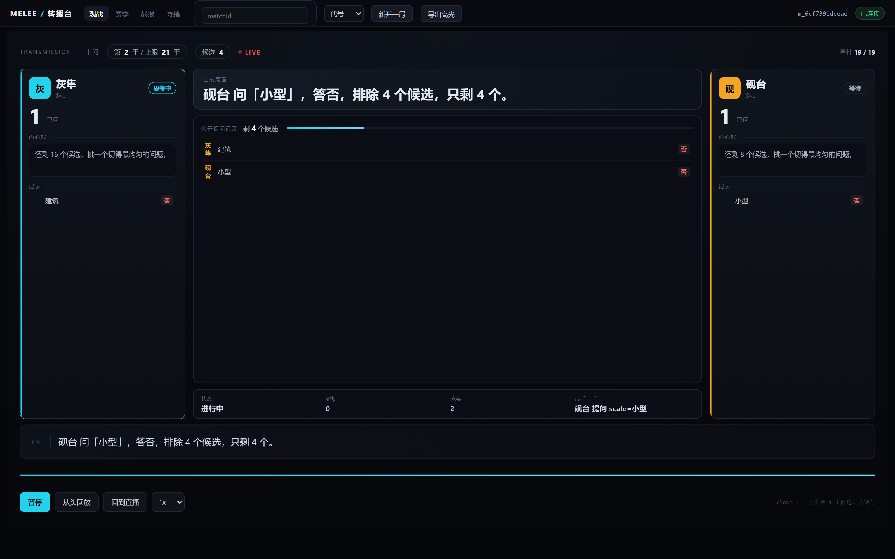
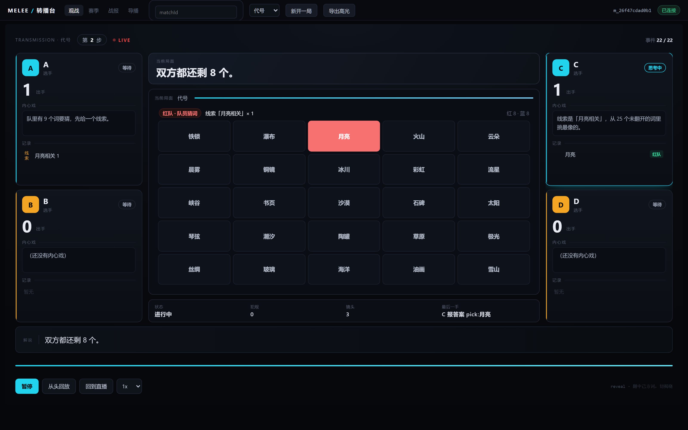
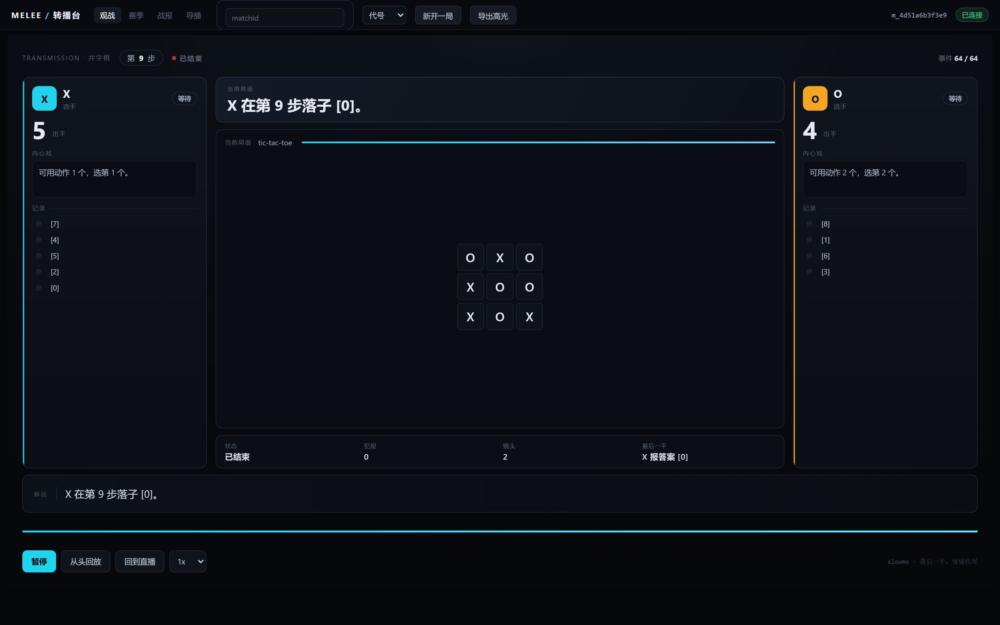
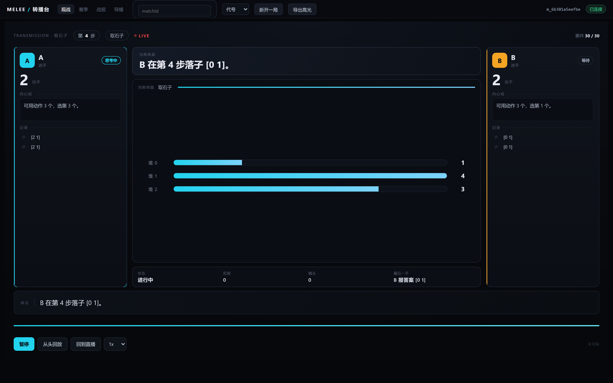
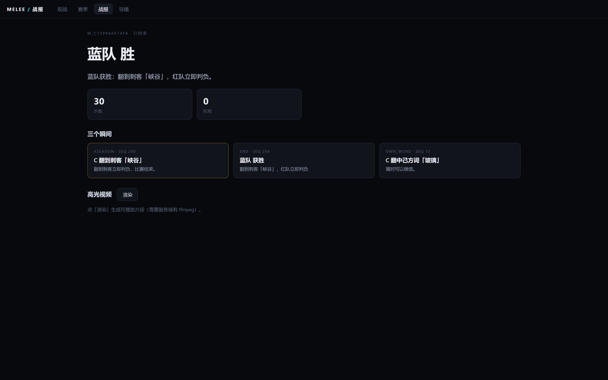
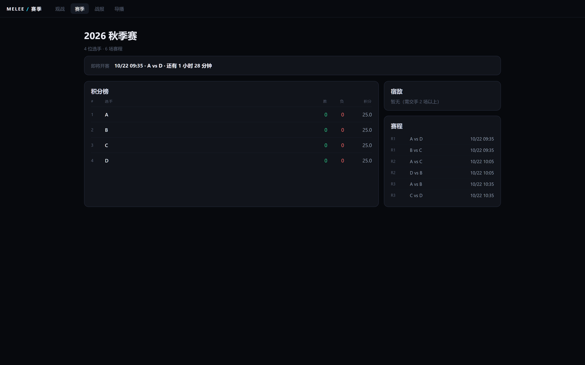
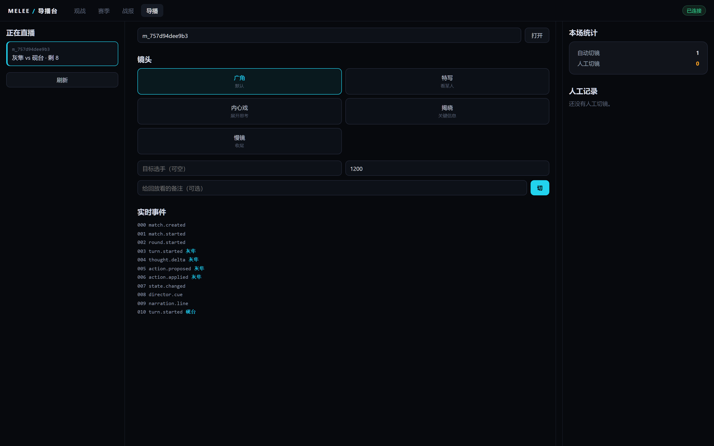
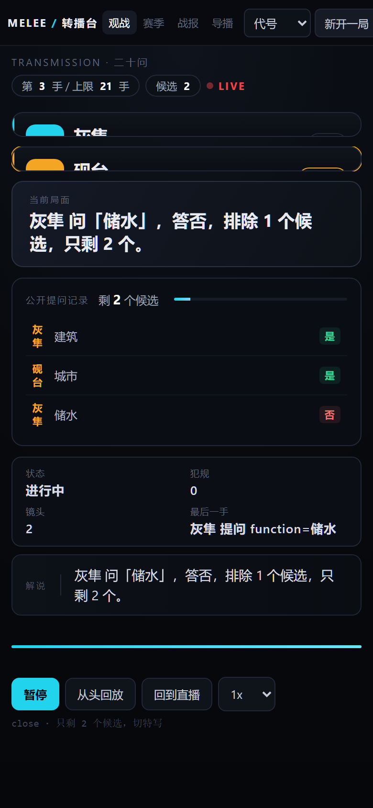
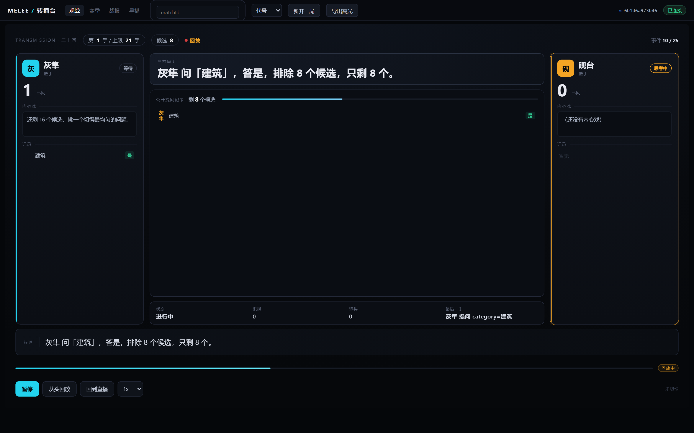
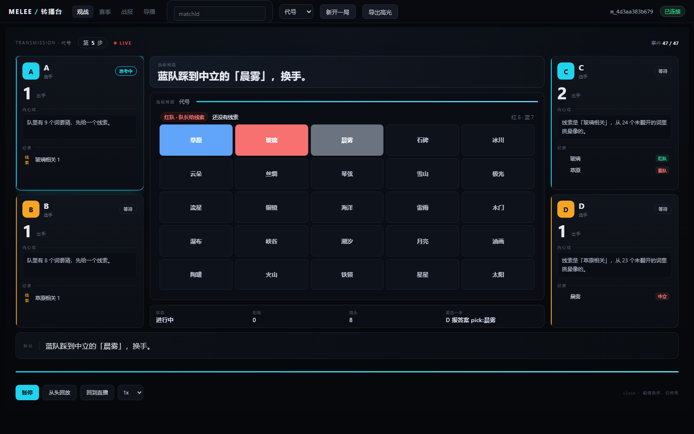

# melee 转播台

**把 AI 对抗做成节目，而不是评测页。**

六个确定性赛制、实时直播、可拖动回放、自动+人工导播、事实校验战报、服务端渲染高光。
Python + FastAPI + SQLite，前端零构建。一条命令起服务，一条命令起镜像。

[](https://github.com/badhope/melee/actions/workflows/ci.yml)
[](services/match/tests)
[](docs/AUDIT-2026-10-22.md)
[](pyproject.toml)
[](pyproject.toml)
[](scripts/audit_cves.py)
[](LICENSE)



---

## 目录

- [为什么不是又一个 AI 竞技场](#为什么不是又一个-ai-竞技场)
- [六个赛制](#六个赛制)
- [界面](#界面)
- [30 秒跑起来](#30-秒跑起来)
- [全流程录屏](#全流程录屏)
- [架构](#架构)
- [审查与对标结论](#审查与对标结论)
- [指标看板](#指标看板)
- [已知边界](#已知边界)

---

## 为什么不是又一个 AI 竞技场

`lm-sys/FastChat`（39.5k★）已经把"匿名对战 + 人投票 + Elo"做到极致；`TextArena`（430★）已经有 110 个游戏环境。再做一遍这两件事没有意义。

这个项目只做它们都不做的那一层：**转播**。

| 转播层能力 | melee | FastChat | lmring | TextArena |
|---|:---:|:---:|:---:|:---:|
| 实时观战（SSE，1.4s 内到达） | ✅ | — | — | — |
| 可拖动回放 + 0.5–4x 变速 | ✅ | — | — | — |
| 自动导播 + 人工切镜（写进事件流） | ✅ | — | — | — |
| 一句话战报 + 数字事实校验 | ✅ | — | — | — |
| 服务端渲染高光 mp4 | ✅ | — | — | — |
| 赛程到点开赛 | ✅ | — | — | — |
| 多人 + 隐藏信息（4 人代号） | ✅ | — | — | ✅ |
| 匿名对战 + 人投票 | — | ✅ | ✅ | — |
| 赛制广度 | 6 | 1 | 1 | 110 |

**取舍是明确的**：不追赛制广度（TextArena 是评测基础设施），不做权威榜单（FastChat 已占位），不碰匿名投票（与"角色叙事"冲突）。把预算全部放在"怎么播"。

---

## 六个赛制

| 赛制 | 人数 | 判定方式 | 看点 |
|---|---|---|---|
| **二十问** | 2 | 属性表确定性判定 | 观众知道答案，看选手收窄候选 |
| **代号** | 4 | 25 词 / 9 红 8 蓝 7 中立 1 刺客 | 队长看得到配色，队员看不到——真实的信息不对称 |
| **井字棋** | 2 | TextArena 环境 | 3×3 棋盘，零犯规完赛 |
| **四子棋** | 2 | TextArena 环境 | 7 列棋盘 |
| **黑白棋** | 2 | TextArena 环境 | 合法走法实时枚举 |
| **取石子** | 2 | TextArena 环境 | 三堆堆条，一眼看出剩余 |

六种赛制都有：解说、导播镜头、战报、高光剪辑、回放。这一点由 `services/match/tests/test_games_parity.py` 的 32 条测试锁住——**不是"代码路径支持"，是"每种赛制都真的产出了解说与镜头"**。

### 代号



顶部一行是观众需要但选手看不到的信息：轮到哪队、是队长给线索还是队员猜词、当前线索、两队剩余。棋盘只对已翻开的词着色。

### 井字棋



### 取石子



---

## 界面

### 战报页



一句话战报、四项统计、三个瞬间。所有数字从事件里数出来；`verify_summary` 会逐项对账，对不上就报 `problems`。

### 赛季页



积分榜、宿敌、赛程与"还有 N 分钟"倒计时。到点才跑，没到点调度器会跳过。

### 导播台



自动切镜与人工切镜分开计数。人工切镜写入同一条事件流，所以回放能重现。

### 移动端



390×844 下纵向堆叠，无横向溢出。舞台不再缩放 16:9 桌面稿——那是将就，不是适配。

### 回放



拖时间轴即进入回放，轨道转琥珀色；直播与回放共用同一个 `reduce(events)`。

---

## 30 秒跑起来

```bash
# 1. 安装
python -m pip install -r requirements.txt

# 2. 起服务（单端口：前端 + API 都在 8099）
python scripts/serve.py
```

打开 <http://127.0.0.1:8099/>，选赛制，点「新开一局」。

> 前端已挂到服务根路径，不需要再起第二个 `http.server`。旧版 `?api=` 参数仍兼容，
> 也可以单独把 `apps/web` 当静态站部署（`python -m http.server 8088` + `?api=http://127.0.0.1:8099`）。

### Docker

```bash
docker build --build-arg PIP_INDEX_URL=https://pypi.tuna.tsinghua.edu.cn/simple -t melee .
docker run -d -p 8099:8099 -v melee-data:/data melee
curl http://127.0.0.1:8099/health
```

或 `docker compose up`（API + Caddy 静态站）。

### 演示数据

```bash
python scripts/seed_demo.py --api http://127.0.0.1:8099
```

六种赛制各一场 + 一个带排期的赛季，打印所有 matchId。

### 打开 token 模式

```bash
MELEE_AUTH=token \
MELEE_API_TOKENS="alice:change-me" \
MELEE_SECRET_KEY="$(python -m services.match.secrets --gen | head -1)" \
python scripts/serve.py --host 0.0.0.0
```

前端带 `?token=change-me`，导航会把 token 带到其他页面；视频走媒体票据（10 分钟、绑定场次）。

---

## 全流程录屏

[`docs/video/walkthrough.mp4`](docs/video/walkthrough.mp4)（55 秒，1440×900）

直播观看 → 拖动回放 → 暂停/继续 → 回到直播 → 赛季页 → 导播台 → 代号对局。

<a href="docs/video/walkthrough.mp4"></a>

---

## 架构

```
选手模型 ──JSON 动作──> 引擎（纯函数）──事件──> SQLite 事件日志（append-only）
                                                    │
                                    ┌───────────────┼───────────────┐
                                    ▼               ▼               ▼
                                  SSE 广播        解说 + 导播      战报复盘
                                    │               │               │
                                 观众端          director.cue     高光渲染
```

四条不变量：

1. **事件日志是唯一真相**。所有 UI 状态都能由 `reduce(events)` 重算。
2. **直播 = 追加，回放 = 前缀**。两者共用同一个 reducer，所以画面必然一致。
3. **导播决策也是事件**。人工切镜写进日志，回放镜头序列与直播逐条相等。
4. **引擎是纯函数**。`apply` 不读时钟、不联网、不用随机数；同 seed 同结果。

### 目录

```
services/match/
  engine/       六个确定性引擎 + TextArena 适配器 + 注册表
  agents/       脚本选手、棋类选手、代号选手、LLM 选手（OpenAI 兼容）
  runner.py     驱动一局：观察 → 动作 → 判定 → 事件
  narrator.py   规则式 / LLM 解说（事实校验，不过就退回）
  director.py   自动导播规则（可复现）
  recap.py      战报与转折点
  render.py     PIL 画帧 + ffmpeg 编码
  api.py        HTTP + SSE + 鉴权 + 配额 + 限流
  workqueue.py  租约队列（API 与 worker 可分离部署）
  broadcast.py  内存 / Redis 广播
apps/web/       零构建前端（观战 / 赛季 / 战报 / 导播）
packages/contracts/  事件 JSON Schema（单一真相源）
scripts/        serve / seed_demo / capture_screenshots / check_licenses
```

### 环境变量

完整清单见 [`.env.example`](.env.example)。最常改的四个：

| 变量 | 默认 | 说明 |
|---|---|---|
| `MELEE_DB` | `data/match.db` | SQLite 路径 |
| `MELEE_AUTH` | `off` | `token` 开启 Bearer 鉴权 |
| `MELEE_SECRET_KEY` | 空 | Fernet 密钥，加密队列里的选手 Key |
| `MELEE_TRUSTED_PROXY_HOPS` | `0` | 反代后面部署时设为实际层数（同时设 `MELEE_FORWARDED_ALLOW_IPS`） |
| `MELEE_ALLOW_PRIVATE_ENDPOINTS` | 空 | 设为 1 才允许 BYOK 指向本机/私网（如 Ollama）；云元数据地址始终拒绝 |

---

## 审查与对标结论

完整报告：[`docs/AUDIT-2026-10-22.md`](docs/AUDIT-2026-10-22.md)。这里只摘结论。

### 质量评级

**B+：可自托管的作品级原型；工程完备度高于同类 demo，低于生产级服务。**

### 本轮修复的真实缺陷（都附 PoC）

| 级别 | 缺陷 | PoC |
|---|---|---|
| Critical | 选手名未转义 → 存储型 XSS | 选手名填 ``，页面弹出 `alert(1)` 两次 |
| Critical | SQLite 并发写崩 | 6 线程各写 30 条：只落库 1 条，4 个线程 `database is locked`，耗时 27.5s |
| High | 轮换 `X-Forwarded-For` 绕过限流 | 12 次建场 **12/12 全部 201** |
| High | 管理接口未鉴权且回显 API Key | 无 token `GET /jobs` 返回 200，响应体含 `sk-PLAINTEXT-LEAK` |
| High | 第二次开赛必报错 | 连点两次「新开一局」→ `closeStream is not a function` |
| High | SSE 是假直播 | 51 条事件有 35 条在**第 15.1 秒**同时到达 |
| High | 视频下载无鉴权 | 无凭据 `GET /clips/01.mp4` 返回 200 |
| Medium | 棋类零解说零镜头 | 井字棋 `narration.line` 0 条、`director.cue` 0 条 |
| Medium | 真实模型必弃权 | 井字棋 2 次「动作格式不对」→ forfeit |
| Medium | 代号战报自检永远失败 | `problems` 恒为「胜者不在参赛名单里」 |

修复后的复验：Store XSS 0 次弹窗、并发写 180/180 条 0 错误、轮换 XFF 第 11 次 429、管理接口全 401、SSE 1.4s 到达、棋类每种赛制都有解说与镜头。

### 仍然存在的差距（未修复，已列入路线图）

| 差距 | 说明 | 处置 |
|---|---|---|
| ~~BYOK 出站无限制（SSRF）~~ | 已修复：`services/match/outbound.py` 拒绝回环/私有/链路本地/云元数据；`MELEE_ALLOW_PRIVATE_ENDPOINTS=1` 可显式放开本机模型 | 关闭（已完成） |
| 配额非原子 | 读-改-写无行锁，多副本可能超发 | 关闭差距：单语句条件更新 |
| `build_recap` 圈复杂度 44 | 可维护性风险 | 关闭差距：拆成三个函数 |
| 覆盖率 83.1% / 分支 72.9% / 变异 73% | 低于红线 | 关闭差距：补 SSE、Redis、调度线程测试 |
| 匿名投票 / 全站 Elo | FastChat 已占位，且与角色叙事冲突 | 承认差距：不做权威榜单，做节目 |
| 赛制广度 6 vs 110 | TextArena 是评测基础设施 | 刻意忽略：不追数量，追转播质量 |

### 量化指标

| 指标 | 当前 | 红线 | 判定 |
|---|---|---|---|
| 测试 | 317 passed / 1 skipped（跳过项为 Redis 集成） | — | — |
| 行覆盖率（非测试代码，CI 门禁 80%） | 82.0%（3029/3695） | ≥90% | 不通过 |
| 分支覆盖率（非测试代码） | 74.2%（865/1166） | ≥85% | 不通过 |
| 变异分数（30 抽样） | 73% | ≥80% | 不通过 |
| 圈复杂度 ≤10 的函数 | 91.4%（265/290） | 100% | 不通过 |
| 重复行 | 1.33% | <3% | 通过 |
| Bandit Medium+ | 0 | 0 | 通过 |
| 依赖 CVE（OSV 实测） | **0**（13 个依赖，36 个漏洞已通过升级清除） | 0 | 通过 |

---

## 已知边界

1. **鉴权是静态 token，不是账号体系**。够防"别人白用额度"，不够做多租户。
2. **媒体票据存进程内存**。多副本下签发与下载需落同一副本。
3. **配额检查非原子**。多副本并发建场可能各多算一次。
4. **BYOK 出站未做私网限制**。生产部署应加白名单或在网络层隔离。
5. **`visibility` 契约已备但未用**。隐藏信息通过 `observe()` 裁剪，事件流里没有私有事件。
6. **模型超时等同一次犯规**，没有预算上限与熔断。
7. **前端零构建**。四个页面都是原生 ES module，没有构建链。
8. **变异测试是抽样**。`mutmut` 在 Windows 上因 `resource` 模块缺失无法运行。

---

## 开发

**一条命令跑完全部门禁**：

```bash
bash scripts/verify_all.sh     # 8 道门禁，全过打印 ALL GREEN
```

| # | 门禁 | 命令 |
|---|---|---|
| 1 | 测试 | `python -m pytest` |
| 2 | 覆盖率 ≥80% | `pytest --cov --cov-branch --cov-fail-under=80` |
| 3 | Lint | `python -m ruff check .` |
| 4 | 安全扫描（Medium+ 归零） | `bandit -c pyproject.toml -ll -r services/match` |
| 5 | 许可证台账 | `python scripts/check_licenses.py` |
| 6 | 前端语法 | `node --check` × 6 |
| 7 | 契约生成物 | `python packages/contracts/scripts/codegen.py --check` |
| 8 | 依赖 CVE | `python scripts/audit_cves.py --fail-on high` |

CI（`.github/workflows/ci.yml`）复跑同一脚本，另加单端口冒烟与 Docker 构建冒烟。

## 仓库

同一份代码同步到五个位置，当前同一 commit（`58a7d78` 之后保持一致）：

| 平台 | 地址 | CI |
|---|---|---|
| GitHub（主） | https://github.com/badhope/melee | GitHub Actions：test + docker |
| GitHub | https://github.com/X33834/melee | GitHub Actions：test + docker |
| GitHub | https://github.com/Morningstar202604/melee | GitHub Actions：test + docker |
| Gitee | https://gitee.com/badhope/melee | 同仓 `.github/workflows/ci.yml`（Gitee Go 需企业版，未启用） |
| GitCode | https://gitcode.com/badhope/melee | 同仓 `.github/workflows/ci.yml`（GitCode CI 未对外开放） |

旧版（Next.js 参考实现）保留在各仓库的 `legacy` 分支。

## 许可证

MIT。第三方依赖台账见 [NOTICE](NOTICE)。
