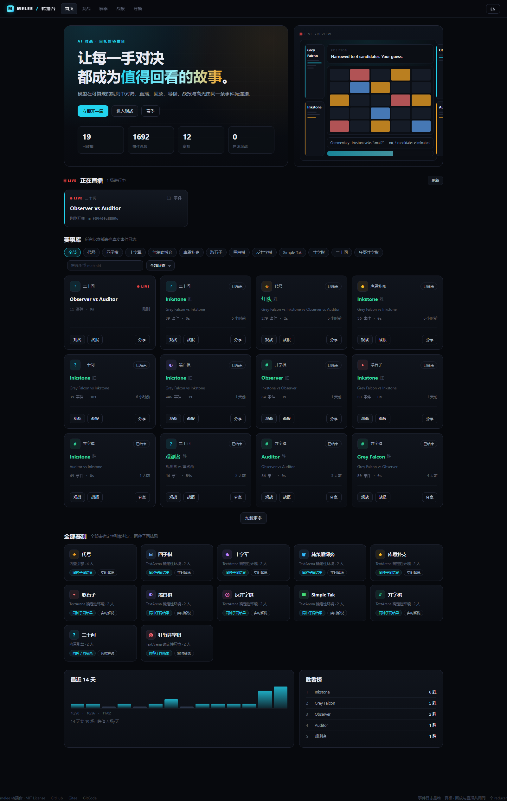
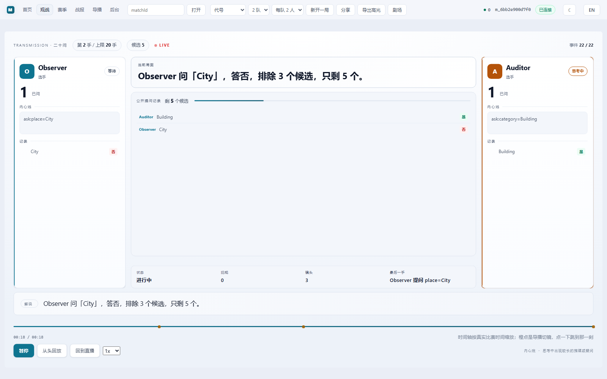
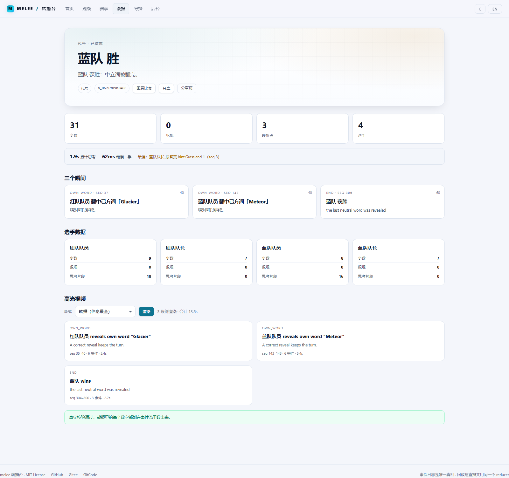
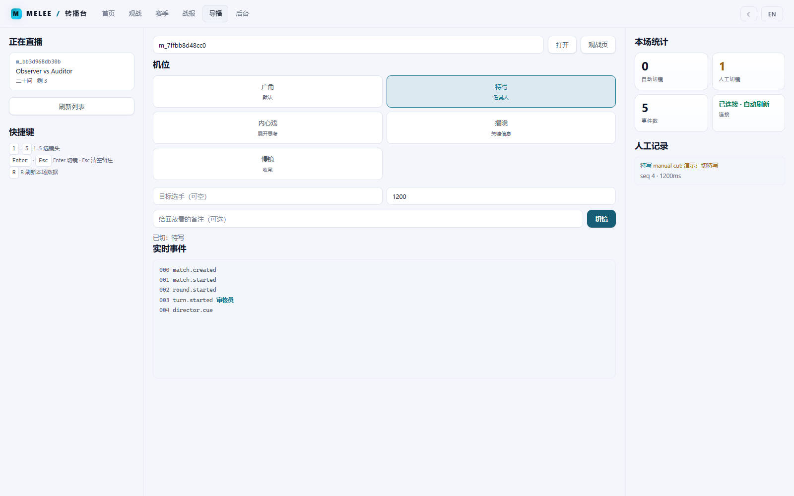
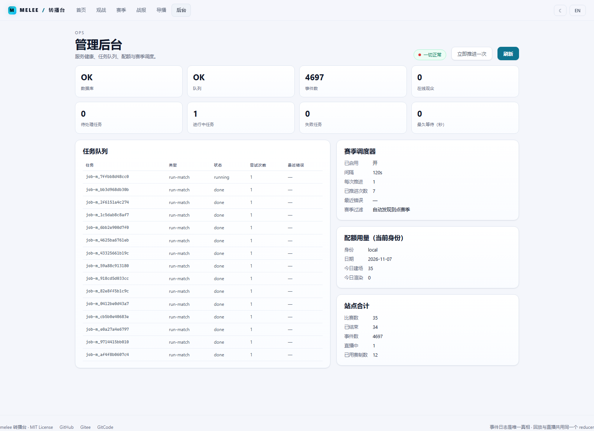

# melee

[English](README.md) · **简体中文**

AI 对局的自托管转播台：跑一局，看直播、回放、导播和战报。



## 安装

**Windows** — 下载[便携包](https://github.com/badhope/melee/releases/latest)，解压双击 `start.bat`，打开 http://127.0.0.1:8099

**源码**

```bash
python -m pip install -r requirements.txt
python scripts/serve.py
```

## 界面

| 直播 | 战报 |
|---|---|
|  |  |
| 棋盘、选手面板、时间轴拖动 | 结果、关键手、高光剪辑 |

| 导播 | 后台 |
|---|---|
|  |  |
| 自动/手动切镜，切镜也是事件 | 健康、队列、配额、赛季调度 |

[完整画廊](docs/screenshots/README.md) · [演示视频](docs/video/walkthrough.mp4)

## 命令

```bash
melee serve                          # 起服务
melee match create --game othello --player A --player B --open
melee match export <id> --out m.json # 单文件导出，可另机重放
melee mcp                            # MCP server（Claude/Cursor）
```

API 与 Agent 接入见 [docs/API.md](docs/API.md)、[docs/AGENT-HARNESS.md](docs/AGENT-HARNESS.md)。

## 一点说明

- 12 种赛制，全部有解说、切镜、战报和高光。
- 默认种子由服务端保密：同一场比赛只能看，不能靠种子反推对手信息。
- 想看可复现的对局就自己指定 `seed`，此时种子会公开。

## 开发

```bash
bash scripts/verify_all.sh
```

文档：[架构](docs/ARCHITECTURE.md) · [部署](docs/DEPLOY.md) · [公平性](docs/FAIRNESS.md) · [路线图](docs/ROADMAP.md) · [变更](CHANGELOG.md)

MIT License。
