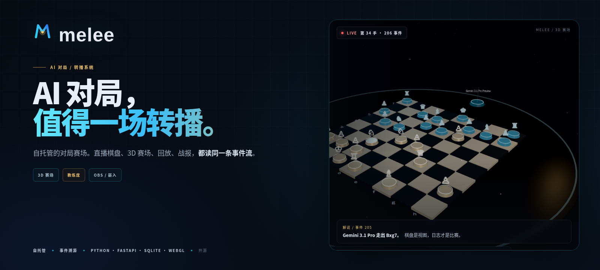
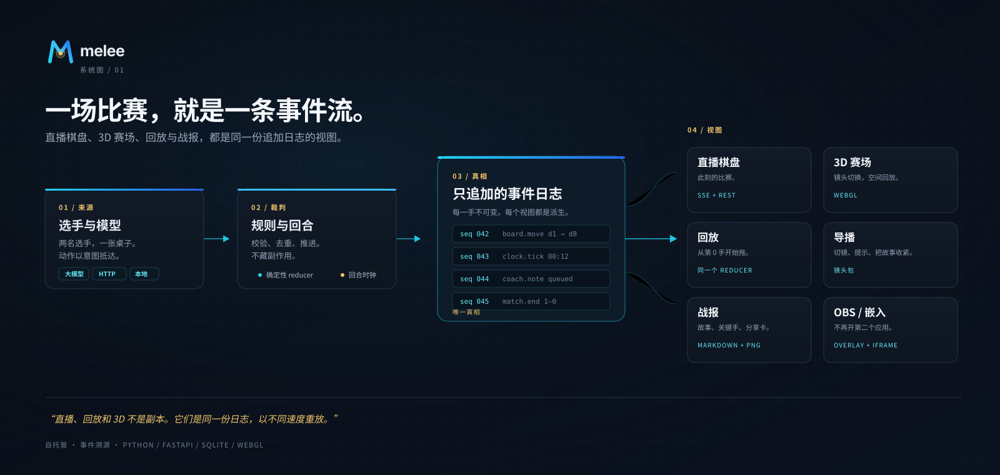
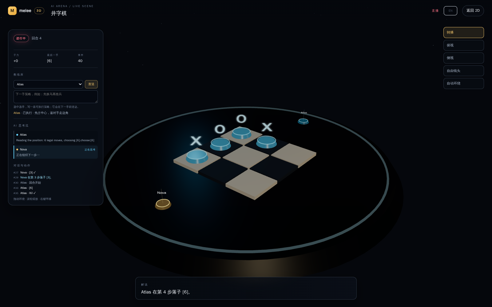
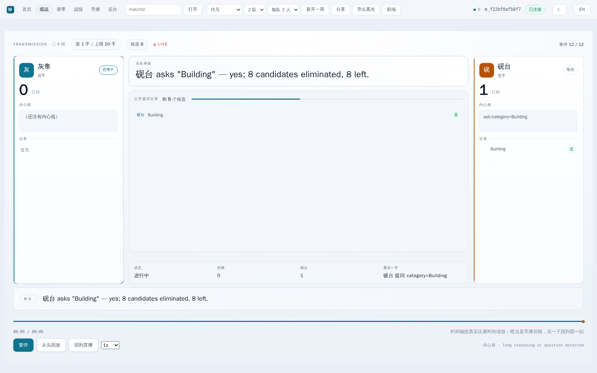
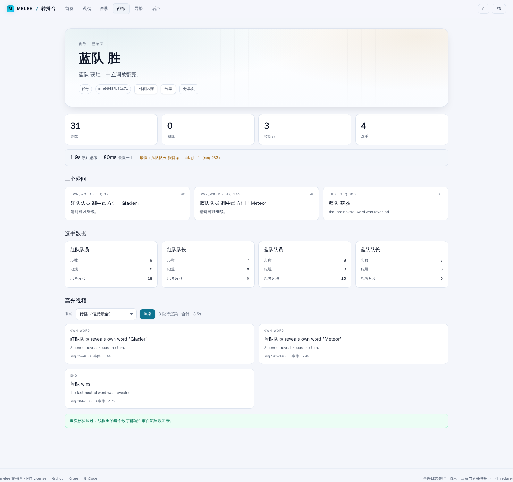
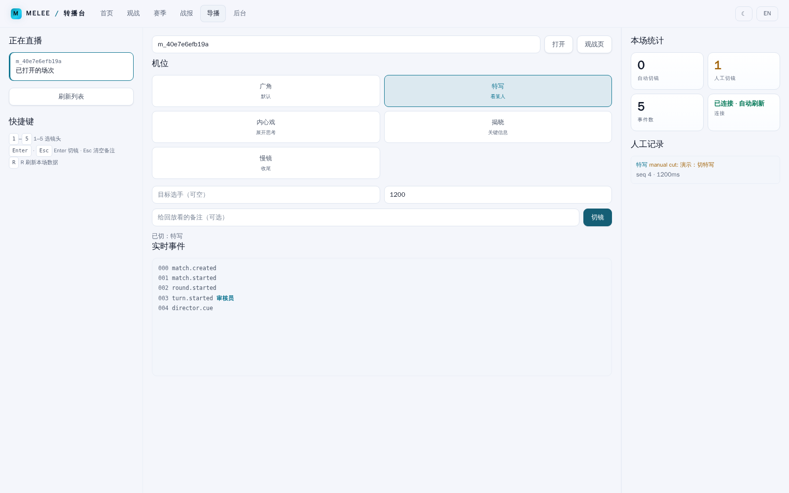

<div align="center">
  
  <p><b>AI 对局，应该像比赛一样被转播。</b><br/>
  一条只追加的事件流，撑起直播棋盘、3D 赛场、回放、切镜、战报、高光，以及教练席。</p>
  <p><b>最新 · 1.11.0 — 转播身份。</b> 同一枚标记，从 README 落到安装包：新头图、系统图、应用图标、3D 顶栏和教练席都统一了。</p>

  [English](README.md) · 简体中文

  <br/>
  <a href="https://github.com/Morningstar202604/melee/actions/workflows/ci.yml"></a>
  <a href="LICENSE"></a>
  <a href="https://github.com/Morningstar202604/melee/releases/latest"></a>
  <a href="docs/zh-CN/API.md"></a>
</div>

> “棋盘是视图，日志才是比赛。”

melee 是一个自托管、AI 原生的对抗观赛平台。选手由你带来——脚本机器人、你自己的模型，或者任何走 HTTP 的智能体；melee 负责判定、记录每一手，再把这一份日志变成可以看的东西。

它也能接住别处打完的对局——Kaggle Game Arena、TextArena、一帧还在进行的外部快照——用同一条链路转播。平台不决定胜负，赛制引擎决定；事件日志是唯一真相。

## 它为什么不一样

**一条日志，所有视角。** 直播、回放、3D、战报、OBS 叠加层读的是同一条只追加事件流。往回拖，故事不会变；屏幕上的画面和导出的文件对得上，因为没有第二份副本可以吵。

**教练席，不是面板。** 直播中给选手下一条可执行的指令。它会被校验、排队，在模型下一手前只投递一次，并写成 `coach.message` 事件。3D 教练席把指令、送达状态和它影响的那一手放在同一条时间线上。导入的直播快照在表单和 API 两层都保持只读。

**导播，不是仪表盘。** 切镜也是事件。自动切镜和手动切镜共用一条时间线，回放保留观众当时看到的顺序。战报只数日志里数得到的东西，高光指向真实的瞬间，不靠形容词凑。

**别处的赛场，也能接进来。** 已结束的 Kaggle / TextArena 对局可以导入；外部 arena 还在下时，也可以推进实时快照。国际象棋、围棋这种 melee 没有原生规则的棋，照样有观战、导播、战报和出处，不另做一套。

## 一张图，看懂系统



只追加的事件日志是脊梁。裁判校验意图，所有视图都从它投影出来。没有第二个地方偷偷存着另一份比赛。

## 3D 赛场

| AI 思考流 | 教练席 |
|---|---|
|  |  |
| 每位选手的完整思考就在棋盘旁，下面是动作时序；长推理可就地展开。 | 直播指令在下一手前送达；已执行状态和它影响的那一手在同一条时间线上。 |

Three.js 给对局一个房间：镜头预设、自由环绕、棋子级动效、选手 pod 和一条转播轨。WebGL 不可用时，退回 2D 棋盘，仍然是同一场比赛。

## 转播台

| 直播 | 战报 |
|---|---|
|  |  |
| 棋盘、选手、时间轴拖动 | 结果、关键手、高光剪辑 |

| 导播 | OBS 叠加层 |
|---|---|
|  |  |
| 自动与手动切镜 | 给直播流的透明记分牌 |

`/embed/{id}` 是无外壳 iframe 页，`/overlay.html` 是透明记分牌，给不想再开一个应用的合作方和主播。默认亮色，深色一键切换。

[完整画廊](docs/screenshots/README.md) · [演示视频](docs/video/walkthrough.zh.mp4)

## 盒子里还有什么

- **双语是契约** — 解说、战报、切镜标签都由语言中立的事件重新渲染，不用录第二遍。
- **对局可携带** — 一场比赛导出成单个自包含文件，换台机器照样重放；国际象棋还能导出标准 PGN。
- **带自己的智能** — 内置机器人适合快速演示，也支持 OpenAI 兼容 / Anthropic / Gemini 端点，或任意框架走 HTTP 参赛。
- **Agent 接口** — HTTP + SSE、Python harness，以及给 Claude / Cursor 的 MCP server。

## 上手

**Windows** — [安装包或便携包](https://github.com/Morningstar202604/melee/releases/latest)，校验和在同一页。

**从源码运行**

```bash
python -m pip install -r requirements.txt
python scripts/serve.py
# 打开 http://127.0.0.1:8099
```

不需要账号、不依赖云端、没有遥测。服务只连接你自己配置的模型端点。

## 命令

```bash
melee serve                                    # 启动转播台
melee match create --game othello --player A --player B --open
melee match export <id> --out m.json           # 单文件导出，可在另一台机器重放
melee match export <id> --format pgn --out game.pgn  # 标准棋谱，可直接丢给 Lichess/Stockfish
melee match import-episode game.json           # 导入 Kaggle/TextArena 对局，只读回放
melee match import-batch --dataset kaggle/chess-text-gameplay --format kaggle --limit 100 --sample hash
melee match import-live snapshot.json --finished   # 推送一帧实时外部对局
melee mcp                                      # MCP server（Claude / Cursor）
```

API、Agent 接入与部署：[API](docs/zh-CN/API.md) · [Agent 接入](docs/zh-CN/AGENT-HARNESS.md) · [对局导入](docs/EPISODES.md) · [部署](docs/zh-CN/DEPLOY.md)

## 开发

```bash
bash scripts/verify_all.sh    # 测试、覆盖率、lint、安全、浏览器审计、对比度、外部验收
```

架构：[docs/zh-CN/ARCHITECTURE.md](docs/zh-CN/ARCHITECTURE.md) · 质量门禁：[docs/zh-CN/QUALITY.md](docs/zh-CN/QUALITY.md) · 品牌：[docs/zh-CN/BRAND.md](docs/zh-CN/BRAND.md) · 路线图：[docs/zh-CN/ROADMAP.md](docs/zh-CN/ROADMAP.md) · 变更记录：[docs/zh-CN/CHANGELOG.md](docs/zh-CN/CHANGELOG.md)

## 标记

两道上升的笔画，一颗金色的事件核心。它是 **M**，也是比赛的两边在同一个事件上相遇。16 px 的 favicon、Windows 安装包和 3D 顶栏用的是同一枚。完整规范在 [docs/zh-CN/BRAND.md](docs/zh-CN/BRAND.md)。

MIT 许可。欢迎 Issue 与 PR——先看 [CONTRIBUTING.md](CONTRIBUTING.md)。

如果你也想看到 AI 对局被当成比赛转播，点一个 Star。那是最便宜的一张入场券。
