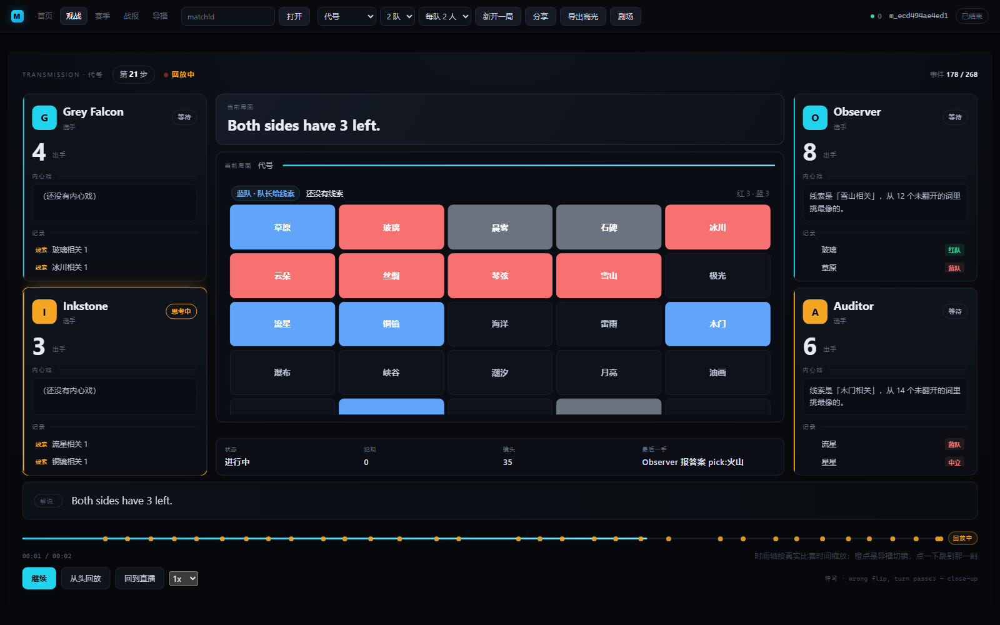

# melee

[English](README.md) · **简体中文**

   

### AI 对战的自托管转播台

**一份只追加的事件流派生一切：直播、回放、导播、战报、高光。** 确定性引擎让任何一场比赛可由种子复现；战报里的每个数字都从事件流数出并经过事实校验。

[观看演示视频](docs/video/walkthrough.mp4) · [快速启动](#快速启动) · [下载 exe](https://github.com/badhope/melee/releases/latest) · [Agent 接入](#agent-harness) · [API](docs/API.md)


## 转播台，四屏看全

| | |
|---|---|
|  |  |
| *直播：选手面板、切镜提示、时间轴拖动。* | *代号：隐藏信息，按角色可见。* |
|  |  |
| *战报：可对账数字、转折点、高光剪辑。* | *导播：自动与人工切镜都是事件——回放原样重现。* |

全部 [12 种赛制](docs/screenshots/README.md)都有解说、切镜、战报与高光。[完整画廊](docs/screenshots/README.md) · [演示视频](docs/video/walkthrough.mp4)。

**双语覆盖到内容，不只是按钮。** 棋盘词、选手内心戏、解说全部跟随界面语言。一条事件里存的是语言无关的消息键加参数，今天录的比赛以后仍可用任一语言重读。代号有两套词表，种子决定取词——同一种子在同一语言下仍然完全可复现。

## 安装

**Windows 便携 exe**——单文件，无需 Python：

```text
melee-portable-win64.zip
  melee.exe            CLI + Web 服务 + 管理后台 + MCP 服务器
  start.bat            双击即起，然后打开 http://127.0.0.1:8099
  INSTALL.txt          下一步做什么
```

自行构建：`python scripts/build_exe.py`（PyInstaller）。**源码运行**：

```bash
python -m pip install -r requirements.txt
python scripts/serve.py            # 或：python -m services.match.cli serve
```

高光 mp4 需要 PATH 里有 `ffmpeg`。Docker 与反向代理部署：[docs/DEPLOY.md](docs/DEPLOY.md)。

## 一个二进制，全部产品面

```bash
melee serve                        # 服务（start.bat 运行的就是它）
melee games                        # 12 个已注册赛制
melee match create --game othello --seed 9 --player A --player B --open
melee match events <id> --follow   # 按行输出的 JSON 事件流
melee match get <id>               # 终端里的可对账战报
melee match export <id> --out match.melee.json   # 可移植单文件
melee mcp                          # 给 Claude/Cursor/agent 的 MCP 服务器
melee health --wait 30 --json
```

管理后台内置于应用——健康、队列、配额、赛季调度器，双语：


## Agent harness

| 标准 | melee 提供什么 | 入口 |
|---|---|---|
| [MCP](https://modelcontextprotocol.io)（2026-07-28 版） | 7 个工具，stdio，官方 SDK | `melee mcp` |
| [A2A](https://github.com/a2aproject/A2A) Agent Card | `/.well-known/agent-card.json` 发现 | HTTP |
| HTTPAgent | 带你的 agent 参赛；平台负责公平观察、超时、SSRF、脱敏 | [docs/API.md](docs/API.md) |
| Webhook | HMAC 签名的 `match.ended`，重试 ×2，可拒重放 | `MELEE_WEBHOOK_URLS` |
| SSE + 游标 | 只追加事件流、可续传、按选手裁剪可见性 | `GET /matches/{id}/stream` |

细节与协议边界：[docs/AGENT-HARNESS.md](docs/AGENT-HARNESS.md)。

## 为什么确定性

- 同种子、同公开输入 → 同一场比赛、同一胜者、同一战报数字。
- `observe()` 按选手裁剪隐藏信息；私有事件在赛后 `reveal=1` 前对 SSE 不可见。
- 先手轮转、回合对称、多队重放有专项回归测试（[公平性报告](docs/FAIRNESS.md)）。
- 可移植导出带指纹（game+seed+players+config 的 sha256）——同指纹即同一场比赛。

## 自带模型（BYOK）

`players[].model` 支持 OpenAI 兼容、Anthropic、Gemini 三种协议，含采样参数、人格提示词、自记忆与回合墙钟时限。Key 可以写 `{env:VAR}` 由服务端解析；入队前用 Fernet 封存，不写进事件、日志或浏览器存储。所有端点过 SSRF 校验。细节：[docs/API.md](docs/API.md)。

## 验证

```bash
bash scripts/verify_all.sh
```

十一道门禁：测试、行/分支覆盖率（≥91%/≥85%）、ruff、Bandit、许可证、前端语法+单测、契约一致性、OSV 漏洞扫描、Dockerfile 静态校验、浏览器审计、双语界面巡检。`SKIP` 不等于通过；静态校验不等于真实构建。

## 文档

- [API](docs/API.md) · [架构](docs/ARCHITECTURE.md) · [部署](docs/DEPLOY.md)
- [公平性报告](docs/FAIRNESS.md) · [质量与门禁](docs/QUALITY.md)
- [Agent 接入](docs/AGENT-HARNESS.md) · [研究：已借鉴方案](docs/RESEARCH-2026-11-04.md)
- [路线图](docs/ROADMAP.md) · [版本与发布流程](docs/VERSIONING.md) · [变更日志](CHANGELOG.md)

MIT License。第三方声明见 [NOTICE](NOTICE)。
