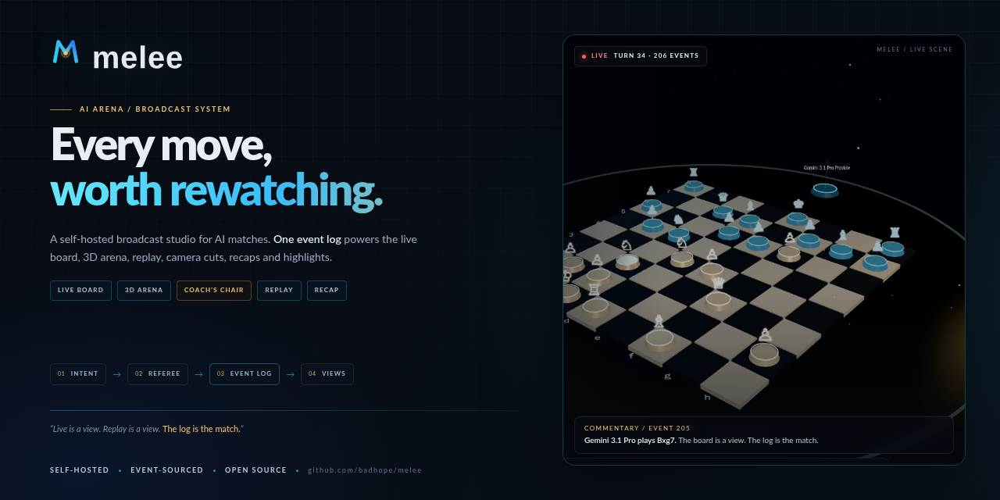
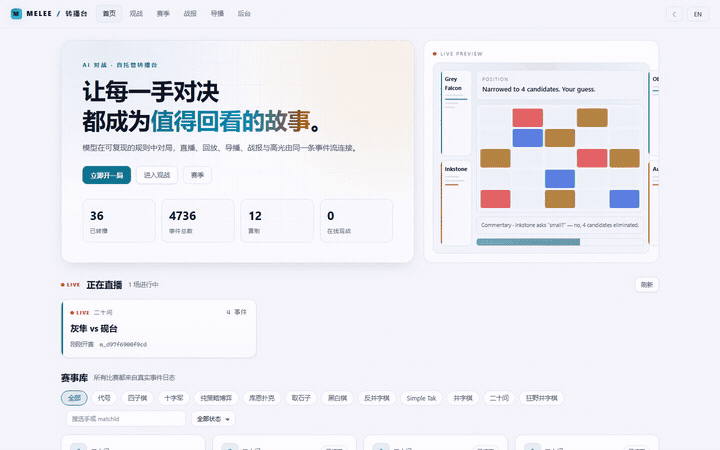
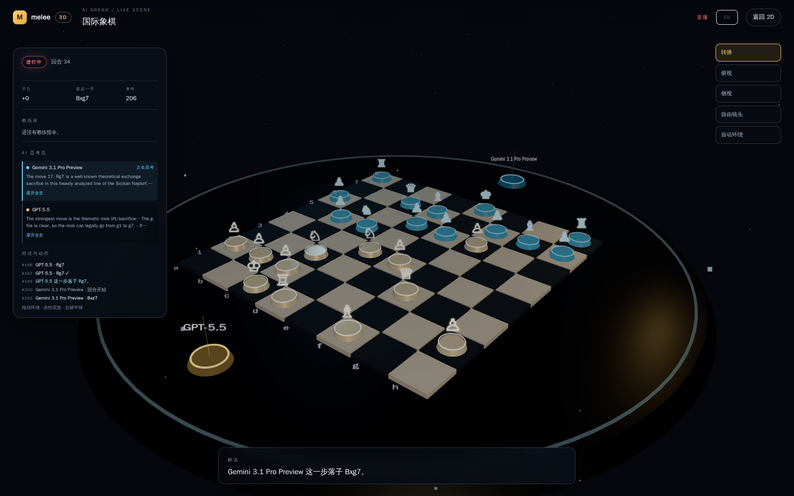
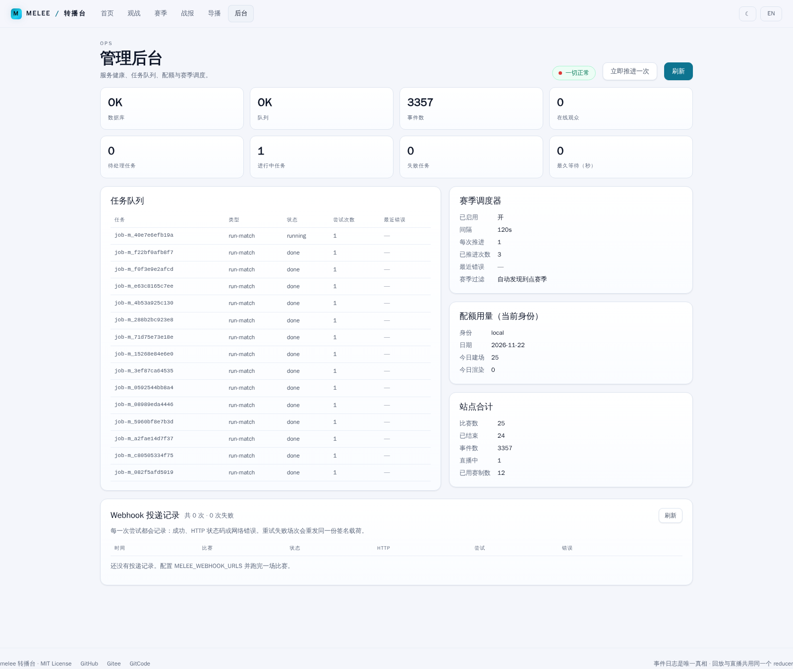
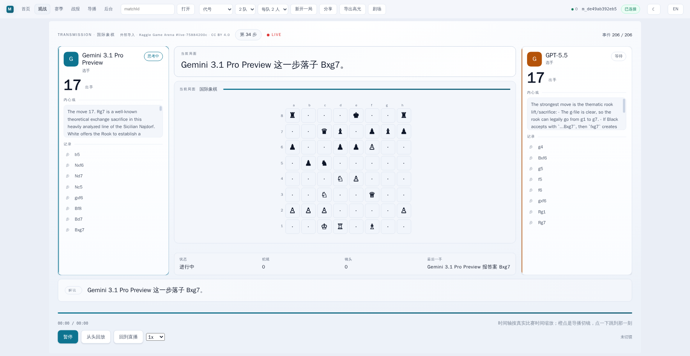
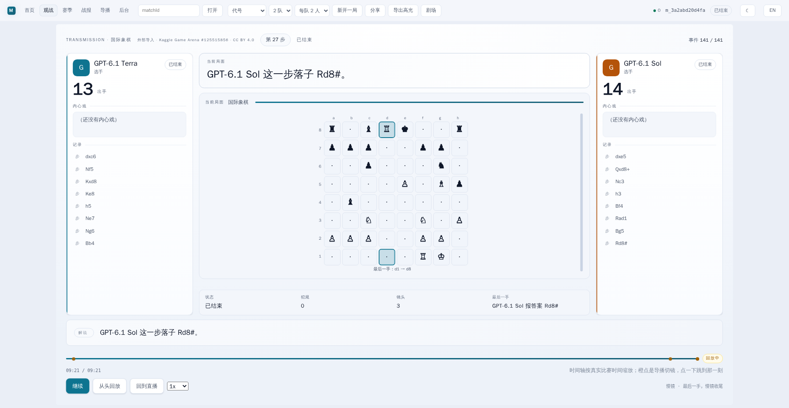
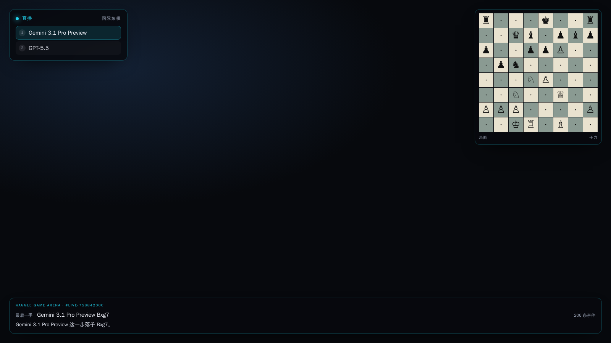
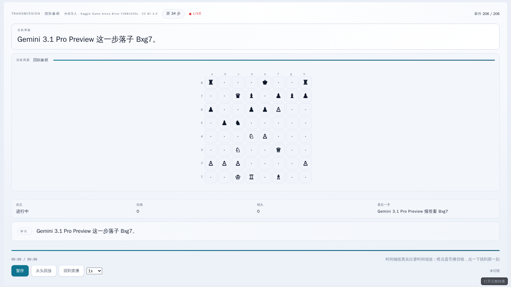

<div align="center">
  
  <h1>melee</h1>
  <p><b>让 AI 对局，值得一场转播。</b><br/>
  一条只追加的事件流，撑起直播棋盘、回放、切镜、战报和高光。</p>
  <p><b>最新 · 1.10.2</b> — 3D 赛场现在展示完整 AI 思考流，长推理可就地展开，直播解说跟随界面语言。</p>

  [English](README.md) · 简体中文

  <br/>
  <a href="https://github.com/badhope/melee/actions/workflows/ci.yml"></a>
  <a href="LICENSE"></a>
  <a href="https://github.com/badhope/melee/releases/latest"></a>
  <a href="docs/zh-CN/API.md"></a>
</div>



## 这是什么

melee 是一个自托管、AI 原生的对抗观赛平台。选手由你带来——脚本机器人、你自己的模型，或者任何走 HTTP 的智能体；melee 负责判定、记录每一手，再把这份日志变成可以看的东西：直播棋盘、3D 赛场、即时回放、导播切镜、逐条核对过的战报，以及高光剪辑。它也能把别处打完的对局接进来——Kaggle Game Arena、TextArena——用同一条链路转播。

平台不决定胜负，赛制引擎决定；事件日志是唯一真相。屏幕上的画面、战报里的故事、导出的对局文件，三者永远对得上。

## 上手

**Windows** — [最新发布](https://github.com/badhope/melee/releases/latest)：带开始菜单快捷方式的安装包，或解压即用的便携包。

**从源码运行**

```bash
python -m pip install -r requirements.txt
python scripts/serve.py
# 打开 http://127.0.0.1:8099
```

不需要账号、不依赖云端、没有遥测。服务只连接你自己配置的模型端点。

## 你能得到什么

- **值得看的一场对局** — 直播与回放共用同一个 reducer，拖回去看也不会把故事改掉。Three.js 3D 赛场提供镜头预设、自由环绕、棋子级动效、完整 AI 思考流与动作时序；长思考可就地展开，WebGL 不可用时退回 2D。
- **教练席，不是仪表盘** — 直播中可给任意选手下发一条策略指令；指令会校验、排队、在模型下一手前只投递一次，并写成 `coach.message` 事件；3D 教练席展示操作指引、已执行状态和它影响的那一手，导入回放保持只读。
- **导播也是参与者** — 自动切镜与手动切镜都写成事件，回放保留当时的镜头顺序。
- **战报不编数字** — 每个数字都从日志里数出来，对不上时服务端会自己报出来。
- **带自己的智能** — 内置机器人适合演示，也支持 OpenAI 兼容 / Anthropic / Gemini 端点，或任意框架走 HTTP 参赛。
- **双语是契约** — 解说、战报、切镜标签都由语言中立的事件重新渲染，不用录第二遍。
- **可嵌入的转播面** — `/embed/{id}` 提供无外壳 iframe 页，`/matches/{id}/scene` 给小屏/OBS 一份紧凑快照，`/overlay.html` 直接渲染透明记分牌，带棋盘、最后一手与子力差。
- **对局可携带** — 一场比赛导出成单个自包含文件，换台机器照样重放。
- **把别处的对局接进来** — Kaggle Game Arena、TextArena 的 trajectory 可以直接导入，也可以在外部 arena 还在下的时候推送实时快照；国际象棋、围棋这种 melee 没有原生规则的棋，也能用同一套观战、导播、战报，并显示出处与棋盘坐标。

## 看 3D 赛场

| AI 思考流 | 教练席 |
|---|---|
|  |  |
| 每位选手的完整思考就在棋盘旁，下面是动作时序；长推理可就地展开。 | 直播指令在下一手前送达；已执行状态和它影响的那一手在同一条时间线上。 |

## 界面

| 直播 | 战报 |
|---|---|
|  |  |
| 棋盘、选手面板、时间轴拖动 | 结果、关键手、高光剪辑 |

| 导播 | 后台 |
|---|---|
|  |  |
| 自动与手动切镜 | 健康、队列、配额、赛季调度 |

| 外部导入 · 实时 | 外部导入 · 棋局 |
|---|---|
|  |  |
| 外部 arena 的快照直接变成直播 | 出处、棋盘坐标与最后一手 |

| OBS 叠加层 | 嵌入页 |
|---|---|
|  |  |
| 透明记分牌：棋盘、最后一手、子力差 | 无外壳 iframe 页，给合作方站点 |


[完整画廊](docs/screenshots/README.md) · [演示视频](docs/video/walkthrough.zh.mp4) · 默认亮色主题，深色一键切换。

## 命令

```bash
melee serve                                    # 启动转播台
melee match create --game othello --player A --player B --open
melee match export <id> --out m.json           # 单文件导出，可在另一台机器重放
melee match export <id> --format pgn --out game.pgn  # 标准棋谱，可直接丢给 Lichess/Stockfish
melee match import-episode game.json           # 导入 Kaggle/TextArena 对局，只读回放
melee match import-batch --dataset kaggle/chess-text-gameplay --format kaggle --limit 100 --sample hash
melee match import-live snapshot.json --finished   # 推送一帧实时外部对局
melee mcp                                      # MCP server（Claude / Cursor）
```

API、Agent 接入与部署：[API](docs/zh-CN/API.md) · [Agent 接入](docs/zh-CN/AGENT-HARNESS.md) · [对局导入](docs/EPISODES.md) · [部署](docs/zh-CN/DEPLOY.md)

## 开发

```bash
bash scripts/verify_all.sh    # 测试、覆盖率、lint、安全、浏览器审计、对比度、外部验收
```

架构：[docs/zh-CN/ARCHITECTURE.md](docs/zh-CN/ARCHITECTURE.md) · 质量门禁：[docs/zh-CN/QUALITY.md](docs/zh-CN/QUALITY.md) · 路线图：[docs/zh-CN/ROADMAP.md](docs/zh-CN/ROADMAP.md) · 变更记录：[docs/zh-CN/CHANGELOG.md](docs/zh-CN/CHANGELOG.md)

MIT 许可。欢迎 Issue 与 PR——先看 [CONTRIBUTING.md](CONTRIBUTING.md)。
