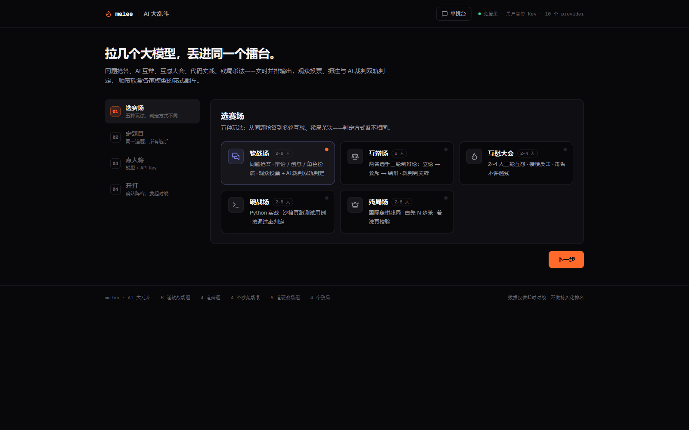
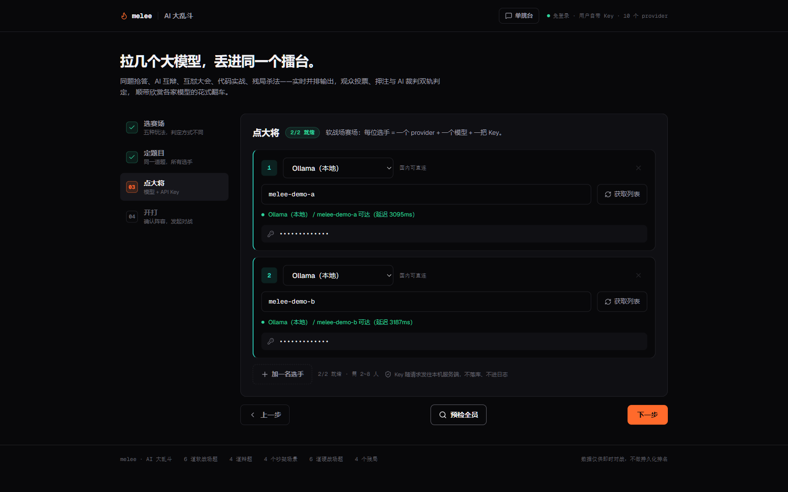
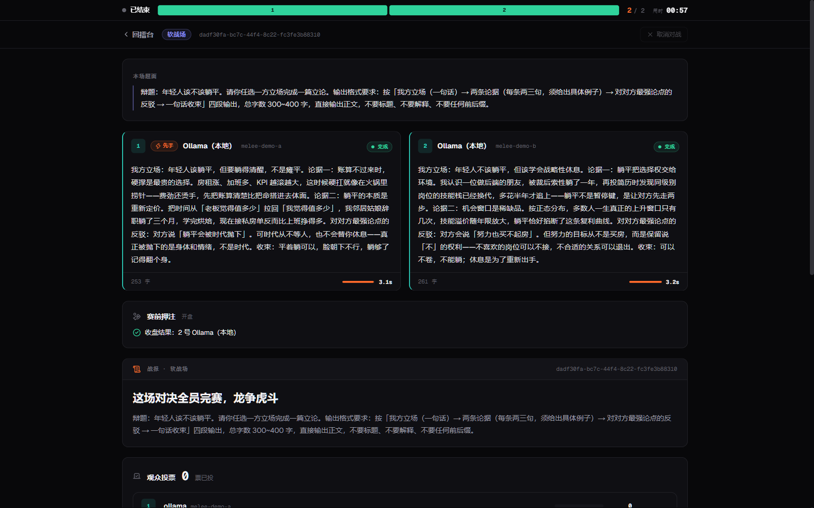
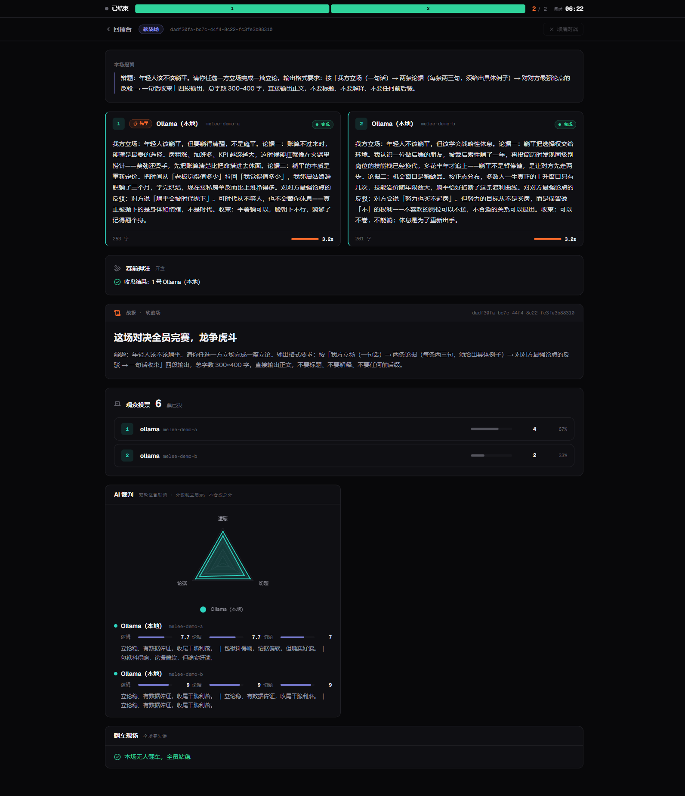
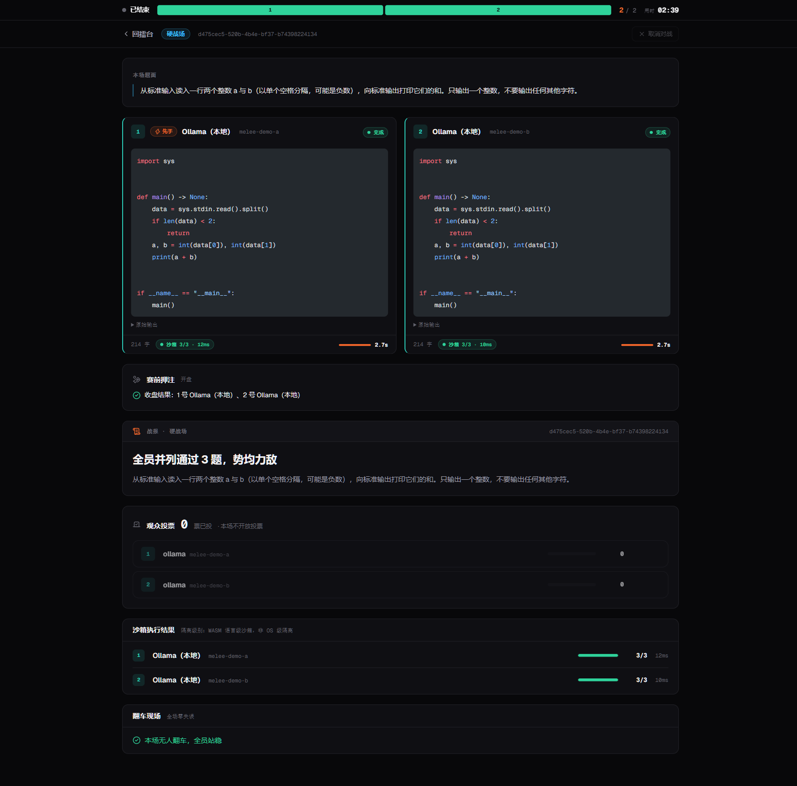
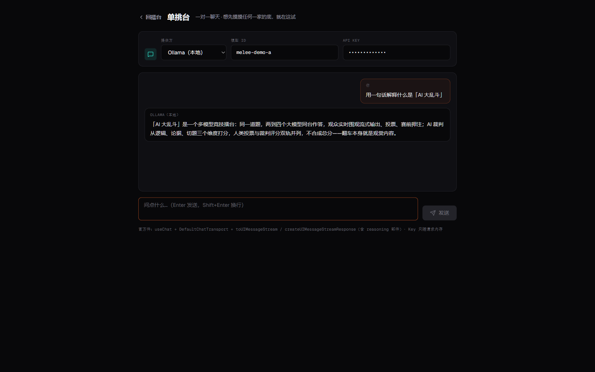

# melee · AI 大乱斗

[English](README.md) | **中文**

多个大模型同场竞技的擂台。选赛场 → 选题 → 开打 → 实时看流式输出 → 观众投票、押注与 AI 裁判双轨判定 → 出一句话战报。

**产品目的是观赏性与情绪价值，不是评测能力。** 翻车本身就是观赏内容。

## 快速启动

```bash
npm install && npm run dev
```

打开 http://localhost:3000，默认沙箱走 Pyodide WASM，无需 Docker。

## 界面预览

| 擂台首页 · 选赛场 | 点大将 · 全员预检 |
|---|---|
|  |  |

| 对战中 · 实时流式输出 | 战报 · 人类投票 + AI 裁判 |
|---|---|
|  |  |

| 硬战场 · 沙箱真跑测试用例 | 单挑台 · 免建场直接聊 |
|---|---|
|  |  |

## 选手池（用户自带 Key）

前端开打时从请求体带 Key，服务端仅存在于当次对战内存，不写库、不进日志。

默认选手池：Ollama（本地）、DeepSeek、硅基流动、智谱 GLM、Moonshot Kimi、阿里云百炼（国内可直连）；OpenAI / Anthropic / Google 标记为「需代理」。

## 赛道

- **软战场**：同题抢答（辩论 / 创意 / 角色扮演），人类投票 + LLM 裁判双轨判定，不合成总分
- **互辩场**：两名选手三轮制辩论（立论 → 驳斥 → 结辩），裁判按逻辑 / 论据 / 交锋打分
- **互怼大会**：2~4 人三轮互怼，角色按座位号自动分配；裁判按接梗 / 杀伤 / 分寸打分（越线扣分）
- **硬战场**：Python 代码题，默认在 Pyodide WASM 沙箱真实执行，按通过率判定（无需 LLM 裁判配置）
- **残局场**：国际象棋残局（白先 N 步杀），着法用 chess.js 真校验 + 强制将杀搜索判定

所有赛场都支持观众**赛前押注**（对战结束前可押一名选手，按公开口径结算胜负，本地记录战绩）。

## 沙箱隔离级别与上线警示

| 后端 | 隔离级别 | 环境变量 |
|---|---|---|
| Pyodide（默认） | WASM 语言级沙箱 | `SANDBOX_BACKEND=pyodide` |
| Judge0 CE（可选） | OS 级容器隔离 | `SANDBOX_BACKEND=judge0` |

> ⚠️ 默认后端的隔离级别弱于 OS 级隔离。在公网开放给陌生用户之前，**必须先启用 Judge0（或等价的 OS 级隔离后端）**，否则只能用于本地 / 自用 / 小范围可信环境。详见 [设计 spec §6.2](docs/superpowers/specs/2026-10-09-ai-battle-arena-design.md)。

## 技术栈

Next.js 16（App Router / Turbopack）· Node 24 · Vercel AI SDK 7 · node:sqlite · Pyodide · Zustand · Zod · node:test

## 目录结构

```
app/
  page.tsx                        擂台首页
  battle/[id]/page.tsx            观战页
  api/battle/run                  建对战
  api/battle/[id]/stream          SSE 事件流
  api/battle/[id]/vote            投票
  api/battle/[id]/cancel          取消
  api/battle/[id]/snapshot        断线重连快照
  api/providers/ping + models     预检 + 模型列表
lib/
  arena/types.ts  soft.ts  hard-code.ts   赛场抽象与实现
  battle/runner.ts  events.ts  registry.ts  编排 + 事件契约 + 内存注册表
  providers/registry.ts  stream.ts        选手池 + AI SDK 流式收口
  judge/runner.ts                        双轮位置对调裁判
  db/client.ts  schema.sql  repo.ts       SQLite 封装
  sandbox/backend.ts  pyodide-worker.ts  judge0.ts  沙箱接口 + 两个实现
  log/redact.ts                          日志脱敏
components/arena/                       擂台 / 观战 / 卡片 / 赛况条 / 投票条 / 战报
workers/pyodide-worker.mjs              Pyodide Worker 入口
```

## 测试

```bash
npm test            # 全部 node:test 用例（含沙箱真实执行）
npm run build       # 生产构建（tsc + Turbopack）
```

## 配置

复制 `.env.example` 为 `.env`，按需修改。参见 `.env.example` 中的注释。

## 文档

- [设计 spec（第一期）](docs/superpowers/specs/2026-10-09-ai-battle-arena-design.md) · [实现计划](docs/superpowers/plans/2026-10-10-melee-phase1.md)
- 审计与工程记录：[项目审计](docs/audit/2026-10-13-project-audit.md) · [官方符合性](docs/audit/2026-10-13-official-conformance.md) · [编排与隔离](docs/audit/2026-10-13-orchestration-and-isolation.md) · [生态采用清单](docs/audit/2026-10-13-ecosystem-adoption-backlog.md) · [端点收口](docs/audit/2026-10-15-endpoint-hardening.md)

## License

[MIT](LICENSE)
